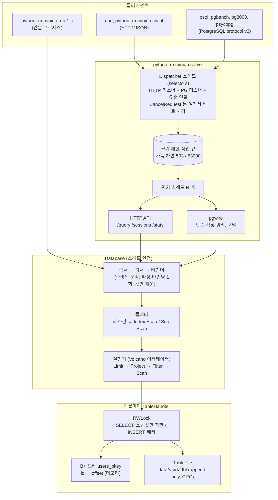
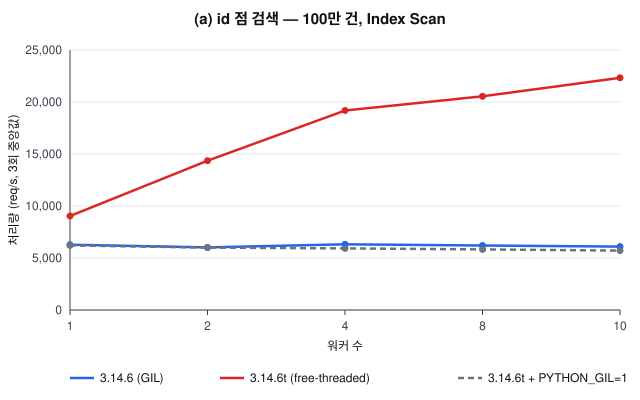
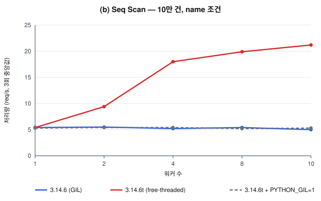

# mini-DBMS

[](https://github.com/yongminkim0501/mini-DBMS/actions/workflows/test.yml)

Krafton Jungle Week 12 DBMS 구현

**파이썬 표준 라이브러리만으로 만든 파일 기반 관계형 DBMS.** PostgreSQL 문법의 부분집합을 실행하고, 오류는 PostgreSQL 과 같은
SQLSTATE·메시지·위치로 알려 준다. 직접 구현한 스레드 풀 서버가 HTTP API 와 **PostgreSQL wire protocol** 을 함께 제공해서,
`psql`·`pgbench`·pg8000·psycopg 가 그대로 접속한다. CPython 3.14 의 GIL 빌드와 free-threaded 빌드(3.14t)에서 모두 동작하고,
두 빌드의 병렬 성능을 측정했다.

실제 터미널 출력 (users 100만 건, 3.14t 서버, 대화형 psql 에서 Ctrl+C):

```text
$ psql -h 127.0.0.1 -p 5433 -U me -d minidb
psql (17.9 (Homebrew), server 16.0)
Type "help" for help.

minidb=# \timing on
Timing is on.
minidb=# SELECT * FROM users WHERE age = 1000;
^CCancel request sent
ERROR:  canceling statement due to user request
Time: 1016.405 ms (00:01.016)
minidb=# SELECT name FROM users WHERE id = 1000001;
  name  
--------
 홍길동
(1 row)

Time: 1.327 ms
```

## 한눈에 보기

| 영역 | 구현 | 핵심 수치 |
|---|---|---|
| 저장 | append-only 레코드 파일, 레코드마다 CRC 2개, 손상 구간 격리(quarantine) 후 열기 | 100만 건 순차 스캔 약 1.9초 |
| SQL | 렉서·재귀 하강 파서·바인더·플래너·이터레이터 실행기, `EXPLAIN [ANALYZE]` | 실제 PostgreSQL 17 과 psql 출력이 바이트 단위로 같음 (검증한 시나리오) |
| 인덱스 | id 기반 메모리 B+ 트리 (벌크 로딩, 맨 오른쪽 분할), 클러스터드 범위 스캔 | `WHERE id = N` 0.04 ms vs Seq Scan 1.9초 (약 47,000배) |
| 동시성 | 테이블별 쓰기 우선 RWLock + 문장 단위 스냅샷 읽기 | 스트레스 테스트: 결과가 항상 커밋된 접두사 `1..k` |
| 서버 | 직접 구현한 워커 풀·selectors 디스패처·HTTP/1.1 (`http.server`·`ThreadPoolExecutor` 없음) | 3.14t 에서 GIL 빌드의 2.7–3.9배 |
| PG 프로토콜 | 시작 단계, 단순/확장 쿼리, `$n` 파라미터, 준비된 문장, 바이너리 형식, 쿼리 취소 | pgbench prepared 최대 23,793 tps, 243회 실패 0 |

| Phase | 내용 | 문서 |
|---|---|---|
| 0 | 저장 계층(포맷 v2: 레코드 CRC + quarantine 복구), 스키마 카탈로그, SQLSTATE 에러 체계 | [storage-format](docs/storage-format.md) |
| 1 | SQL 처리기: 렉서·파서·AST, 바인더·플래너·실행기, psql 형식 CLI | [sql-grammar](docs/sql-grammar.md), [execution](docs/execution.md) |
| 2 | id B+ 트리 인덱스, Index Scan, SET/SHOW, 100만 건 비교 | [bptree](docs/bptree.md), [phase2-report](docs/phase2-report.md) |
| 3 | 동시성 제어, 스레드 풀 + HTTP API 서버, 3.14 vs 3.14t 병렬 성능 | [server](docs/server.md), [phase3-report](docs/phase3-report.md) |
| 3+ | PostgreSQL wire protocol v3, pgbench 벤치마크 | [pg-protocol](docs/pg-protocol.md), [phase3-report §5](docs/phase3-report.md) |

## 아키텍처



- **SQL 파이프라인**: `SQL → 토큰 → AST → 바인딩(이름 해석·타입 검사·값 변환) → 계획 트리 → 행 스트림`.
  각 단계가 다음 단계의 실패를 줄인다: 파서는 스키마를 모르고, 바인더가 끝나면 실행기는 이름이나 타입을 다시 보지 않는다.
- **스냅샷 읽기**: 파일이 append-only 라서, SELECT 는 공유 락을 잠깐 잡고 "지금 파일 끝" 만 기록한 뒤 락 없이 거기까지만 읽는다.
  그래서 긴 스캔이 INSERT 를 막지 않고, 한 문장은 항상 그 시점에 커밋된 행만 본다.
- **유휴 연결은 워커를 쓰지 않는다**: 디스패처가 소켓을 지켜보다가 요청(PG 는 완전한 메시지)이 왔을 때만 워커에 넘긴다.

## 빠른 시작

### 1. 설치와 테스트

[uv](https://docs.astral.sh/uv/) `0.12.0` 과 uv 가 관리하는 CPython `3.14.6` 두 빌드를 쓴다 (CI 와 같은 패치 버전).

```sh
uv python install 3.14.6 3.14.6t
UV_PYTHON_PREFERENCE=only-managed uv run --python 3.14.6+gil pytest   # GIL 빌드
UV_PYTHON_PREFERENCE=only-managed uv run --python 3.14.6t    pytest   # free-threaded 빌드
```

pytest 첫 줄의 `minidb: python 3.14.6, free-threaded build=..., GIL enabled=...` 로 어떤 빌드에서 돌았는지 확인한다
(자세한 함정은 [개발 환경](#개발-환경)).

### 2. 테이블 정의

테이블은 SQL `CREATE TABLE` 이 아니라 스키마 JSON 으로 정의한다. 저장소에 예제 `db/schema/16384.json` 이 있다.

```json
{
  "oid": 16384,
  "table": "users",
  "columns": [
    {"name": "id",   "type": "BIGINT", "auto_increment": true},
    {"name": "name", "type": "TEXT",   "nullable": true},
    {"name": "age",  "type": "BIGINT", "nullable": true}
  ]
}
```

첫 컬럼은 항상 `id BIGINT` 자동 증가(PostgreSQL 의 `GENERATED ALWAYS AS IDENTITY` 와 같은 규칙)이고, 타입은 `BIGINT`, `TEXT` 두 가지다.
데이터는 `db/data/16384.tbl` 에 쌓인다 (파일 이름은 테이블 이름이 아니라 oid).

### 3. CLI 로 실행

```sh
uv run --python 3.14.6t python -m minidb -c "INSERT INTO users (name, age) VALUES ('kim', 25), ('홍길동', 31) RETURNING *" --db ./db
```

```text
 id |  name  | age 
----+--------+-----
  1 | kim    |  25
  2 | 홍길동 |  31
(2 rows)

INSERT 0 2
```

### 4. 서버로 실행하고 psql 로 접속

```sh
uv run --python 3.14.6t python -m minidb serve --db ./db        # HTTP 127.0.0.1:8080 + PostgreSQL 127.0.0.1:5433
psql -h 127.0.0.1 -p 5433 -U me -d minidb                       # 다른 터미널
curl -s -X POST localhost:8080/query -H 'Content-Type: text/plain' --data-binary 'SELECT * FROM users'
```

> ⚠️ **인증이 없다.** HTTP 와 PG 모두 누구나 접속해 모든 테이블을 읽고 쓸 수 있다. 기본 바인딩 `127.0.0.1` 을 바꿔
> 신뢰할 수 없는 네트워크에 노출하지 말 것. TLS 도 없다.

## 지원하는 SQL

```sql
INSERT INTO users (name, age) VALUES ('kim', 25), ('lee', DEFAULT) RETURNING id, name;
SELECT name, age FROM users WHERE age >= 20 AND name <> 'kim' LIMIT 10;
SELECT * FROM users WHERE 5 < id;                -- 리터럴이 왼쪽이어도 된다 (id > 5 로 정규화)
EXPLAIN ANALYZE SELECT * FROM users WHERE id = 777777;
SET enable_indexscan = off;  SHOW enable_indexscan;  SHOW server_version;
SELECT * FROM users WHERE id = $1;               -- 확장 쿼리 프로토콜(준비된 문장)에서만
```

| 지원 | 지원하지 않음 (명확한 오류: 0A000 등) |
|---|---|
| `INSERT ... VALUES` (여러 행, `DEFAULT`, 컬럼 목록 생략), `RETURNING` | `UPDATE`, `DELETE`, `CREATE/DROP`, DDL 전체 |
| `SELECT` 컬럼 목록 / `*`, `WHERE` 비교의 `AND`, `LIMIT n / ALL` | `OR`, `NOT`, `IS NULL`, `IN`, `LIKE`, `ORDER BY`, `JOIN`, 집계, 함수 |
| 비교 연산자 `= <> != < <= > >=`, NULL 3치 논리 | 소수, `E'...'`, `$$...$$` 문자열 |
| `EXPLAIN [ANALYZE]`, `SET` / `SHOW` | 트랜잭션 `BEGIN/COMMIT/ROLLBACK`, `COPY` |
| `$n` 파라미터 (VALUES 값, WHERE 상수 쪽, LIMIT) | SQL 수준 `PREPARE/EXECUTE`, `pg_catalog` |
| 인용 식별자 `"Users"`, 한글 등 비 ASCII 식별자, `public.users` | 다른 스키마·데이터베이스 참조 |

타입 규칙은 PostgreSQL 과 같다: `'31'` 은 bigint 컬럼에 대입·비교할 때 bigint 로 변환되고(`'abc'` → 22P02),
`text = integer` 비교는 42883 `operator does not exist`. 문법 전체(BNF)와 PostgreSQL 과의 차이는 [docs/sql-grammar.md](docs/sql-grammar.md),
바인더 규칙과 NULL 의미론은 [docs/execution.md](docs/execution.md).

### 오류는 PostgreSQL 형식

```text
$ python -m minidb -c "SELECT * FROM users WHERE name = 1" --db ./db
ERROR:  operator does not exist: text = integer
LINE 1: SELECT * FROM users WHERE name = 1
                                       ^
HINT:  No operator matches the given name and argument types. You might need to add explicit type casts.
```

캐럿 위치는 문자 단위로 세고 한글(전각 2칸) 폭을 반영한다. 모든 오류는 SQLSTATE 를 가지며(`minidb/errors.py`),
PG 프로토콜에서는 ErrorResponse 의 C/M/D/H/P 필드로 그대로 나간다.

## 사용법

### CLI

```sh
python -m minidb run script.sql --db ./db [--on-error stop|continue] [--echo] [--timing] [--fsync] [--no-index]
python -m minidb -c "SELECT ..." --db ./db          # SQL 문자열
python -m minidb run - --db ./db < script.sql       # 표준 입력
python -m minidb dump users --db ./db [--limit N]   # 테이블 파일 덤프 (레코드 헤더, CRC, offset)
```

- 스크립트는 문장 단위로 스트리밍한다 (100만 행 INSERT 스크립트도 메모리 일정).
- 실행 전체가 세션 하나다. `--no-index` 는 `SET enable_indexscan = off` 로 시작하는 것과 같다.
- 종료 코드: 성공 0, 문장 오류 1, 사용법/파일 오류 2.

### HTTP API

```sh
curl -s -X POST localhost:8080/query -H 'Content-Type: application/json' \
     -d '{"sql": "INSERT INTO users (name, age) VALUES ('"'"'kim'"'"', 25) RETURNING *"}'
# {"results": [{"command": "INSERT 0 1", "columns": [{"name": "id", "type": "bigint", "type_oid": 20}, ...],
#               "rows": [[1, "kim", 25]], "row_count": 1}], "error": null}

sid=$(curl -s -X POST localhost:8080/sessions | python3 -c 'import json,sys; print(json.load(sys.stdin)["session_id"])')
curl -s -X POST localhost:8080/query -H "X-Session-Id: $sid" -H 'Content-Type: text/plain' --data-binary 'SET enable_indexscan = off'
curl -s localhost:8080/stats        # 풀·연결·PG 지표, 파이썬 빌드, GIL 상태, 프로세스 CPU
```

| 엔드포인트 | 설명 |
|---|---|
| `POST /query` | 본문: `application/json {"sql": "..."}` 또는 `text/plain`. 여러 문장을 순서대로, 첫 오류에서 멈춤. 200 / SQL 오류 400 / 내부 오류 500 |
| `POST /sessions`, `DELETE /sessions/{id}` | SET 값을 요청 사이에 유지하는 세션 (`X-Session-Id` 헤더) |
| `GET /health`, `GET /stats` | 상태 확인, 지표 |

`curl --data-binary` 는 Content-Type 을 주지 않으면 form 인코딩을 보내 415 가 된다. psql 형식으로 보여 주는 클라이언트도 있다:
`python -m minidb client --url http://127.0.0.1:8080 -c "SELECT * FROM users"`. 자세한 내용은 [docs/server.md](docs/server.md).

### PostgreSQL 클라이언트

```sh
python -m minidb serve --db ./db --pg-port 5433               # PG 만 (--http-port 만 주면 HTTP 만, 둘 다 생략하면 둘 다)
psql -h 127.0.0.1 -p 5433 -U me -d minidb                     # user 는 아무 이름, database 는 --pg-database (기본 minidb)
```

```python
import pg8000.native   # 순수 파이썬 드라이버: 3.14t 에서도 GIL 을 다시 켜지 않는다

conn = pg8000.native.Connection("me", host="127.0.0.1", port=5433, database="minidb")
conn.run("INSERT INTO users (name, age) VALUES (:n, :a)", n="홍길동", a=31)   # 값은 Bind 메시지로 따로 간다
print(conn.run("SELECT * FROM users WHERE id = :i", i=1))                     # [[1, '홍길동', 31]]
ps = conn.prepare("SELECT name FROM users WHERE id = :i")                     # 준비된 문장: 파싱은 한 번
print([ps.run(i=i) for i in (1, 2)])
conn.close()
```

- **쿼리 취소**: psql 에서 Ctrl+C 를 누르면 psql 이 새 연결로 CancelRequest 를 보내고, 디스패처 스레드가 워커를 거치지 않고 바로
  취소 플래그를 켠다. 스캔은 1,024 행마다 확인해 57014 로 끝난다. 모든 워커가 바쁠 때도 동작한다.
- **psql 메타 명령**(`\d` 등)은 `pg_catalog` 를 조회하므로 오류가 난다. **트랜잭션이 없다**: DB-API 드라이버(pg8000.dbapi, psycopg2)는
  `conn.autocommit = True` 로 쓴다.
- **인코딩**: UTF8 만 받는다. 대화형 psql 은 로케일에서 client_encoding 을 정하므로 `LANG=C` 면 `SQL_ASCII` 로 거절된다 →
  UTF-8 로케일 또는 `PGCLIENTENCODING=UTF8`.

| 클라이언트 | 확인 | 결과 |
|---|---|---|
| psql 17, 18 | `tests/pgwire/test_psql.py` (로컬 17.9, CI 18.6) | 골든 6개 + CLI 와의 일관성 5개 |
| pgbench 17 | `scripts/pgbench/run_pgbench.py` | simple / extended / prepared, 243회 실패 0 |
| pg8000 1.31 | `tests/pgwire/test_pg8000.py` | 통과 |
| psycopg2 2.9 / psycopg 3.3 | `scripts/compat/check_psycopg.py` (별도 프로세스) | 7/7, 6/6 |

메시지 흐름(시퀀스 다이어그램), 바이트 형식, 준비된 문장이 파싱 비용과 SQL 인젝션을 줄이는 원리, PostgreSQL 과 다른 부분은
[docs/pg-protocol.md](docs/pg-protocol.md).

## 성능

측정 환경: Apple M4 (성능 코어 4 + 효율 코어 6), macOS 15.1, CPython 3.14.6 / 3.14.6t. 원시 결과는 `results/`.

### 인덱스 (100만 건, 단일 스레드)

| 쿼리 | 3.14.6 | 3.14.6t |
|---|---|---|
| `WHERE id = N` Index Scan | **0.040 ms** | **0.046 ms** |
| `WHERE id = N` Seq Scan (`enable_indexscan = off`) | 1,870 ms | 1,931 ms |
| `WHERE id >= a AND id < a+1000` Index Scan | 2.2 ms | 2.2 ms |

범위 검색은 트리로 시작 위치만 찾고 파일을 순차로 읽는다(클러스터드 범위 스캔). 그래서 범위가 전체의 90% 여도 Seq Scan 보다 느려지지 않는다.
→ [docs/phase2-report.md](docs/phase2-report.md)

### 서버 병렬 처리 (HTTP, 동시 요청 32)

| 워크로드 | 3.14.6 +GIL 최대 | 3.14.6t 최대 | 배율 |
|---|---|---|---|
| id 점 검색 | 6,316 req/s (워커 4, 1.39코어) | 22,332 req/s (워커 10, 6.40코어) | 3.5× |
| Seq Scan 10만 건 | 5.5 req/s (워커 2, 1.01코어) | 21.2 req/s (워커 10, 9.70코어) | 3.9× |
| INSERT | 6,609 req/s (워커 1, 1.13코어) | 17,578 req/s (워커 10, 7.00코어) | 2.7× |
| 혼합 (읽기 90%) | 6,245 req/s (워커 2, 1.26코어) | 21,162 req/s (워커 10, 6.58코어) | 3.4× |

<p>


</p>

- GIL 빌드는 워커 수와 무관하게 평평하다. 3.14t 에 `PYTHON_GIL=1` 을 준 대조군도 GIL 빌드와 같다 → 차이를 만든 것은 빌드가 아니라 GIL.
- 3.14t 는 성능 코어 4개까지 거의 선형이고, 그 뒤는 효율 코어 때문에 완만하다.
- INSERT 는 배타 락 구간만 직렬화되고 파싱·HTTP·JSON 은 병렬이라 덜 확장되지만 여전히 늘어난다.

→ [docs/phase3-report.md](docs/phase3-report.md)

### PostgreSQL 프로토콜 (pgbench, -c 32 -j 4 -T 10, tps)

| 워크로드 | 서버 | simple | extended | prepared | HTTP |
|---|---|---|---|---|---|
| point | 3.14.6 +GIL, 워커 4 | 7,404 | 6,145 | 9,263 | 6,316 |
| point | 3.14.6t, 워커 4 | 20,752 | 17,987 | **23,793** | 19,185 |
| insert | 3.14.6 +GIL, 워커 1 | 9,071 | 7,681 | 14,533 | 6,609 |
| insert | 3.14.6t, 워커 1 | 11,928 | 9,794 | **21,809** | 9,596 |

- **prepared** 는 요청마다 하던 렉싱·파싱·바인딩을 빼고 값만 채우므로, 코어 하나에 묶인 경우 23–83% 빠르다.
- **extended** 는 매번 Parse 를 하면서 메시지가 다섯 개로 늘어 simple 보다 느리다.
- GIL 빌드에서 PG 프로토콜이 HTTP 보다 17–81% 빠르다 (헤더 파싱과 JSON 직렬화가 없다).

→ [docs/phase3-report.md §5](docs/phase3-report.md)

## 정확성 검증

| 무엇을 | 어떻게 |
|---|---|
| 저장 계층 손상 복구 | 잘린 꼬리·CRC 불일치·중간 손상 파일을 만들어 열기 판정과 quarantine 결과 검사 |
| 파서 | `parse(to_sql(ast)) == ast` 왕복, 오류 위치(문자 단위, 한글) |
| 인덱스 | B+ 트리 불변식 검사(`check_invariants`), 인덱스 켬/끔 차등 테스트 (결과가 같아야 함) |
| 동시성 | 스트레스 테스트: 동시 INSERT 의 id 가 중복·구멍 없이 연속, 동시 읽기 결과가 항상 `1..k` 이고 k 는 줄지 않음 (엔진·HTTP·PG 각각) |
| 출력 형식 | CLI 골든 출력, psql 골든 출력(실제 PostgreSQL 17 출력과 대조), psql 출력 = CLI 출력 |
| PG 프로토콜 | 표준 라이브러리 소켓으로 만든 미니 클라이언트로 메시지 단위 검사, pg8000 통합, 100만 건 스캔 취소 |

테스트 약 1,060개. CI 는 `{3.14.6+gil, 3.14.6t} × {ubuntu, macos}` 4개 잡에서 돌고, 각 잡이 pytest 헤더로 빌드(free-threaded 여부,
GIL 상태)를 검사한다. 3.14t 잡에서 GIL 이 다시 켜져 있으면 실패한다. psql 을 설치해 psql 호환 테스트가 실제로 실행됐는지도 검사한다.

```sh
uv run --python 3.14.6t pytest -m stress --stress-scale 10    # 스트레스 테스트를 10배 크기로
```

## 개발 환경

| 항목 | 버전 |
|---|---|
| CPython (GIL 빌드) | `3.14.6+gil` |
| CPython (free-threaded 빌드) | `3.14.6t` |
| uv | `0.12.0` |
| 런타임 의존성 | 없음 (표준 라이브러리만) |
| 테스트 의존성 | pytest, pg8000 (순수 파이썬) |

- **표준 라이브러리만 쓰는 이유**: free-threading 을 지원하지 않는 C 확장을 import 하면 3.14t 에서 GIL 이 다시 켜진다.
  실제로 psycopg2 를 3.14t 에서 import 하면 GIL 이 켜지는 것을 확인했다. 그래서 C 확장 드라이버는 pytest 프로세스에서 import 하지 않는다.
- `uv python install` 을 먼저 해야 한다. uv 0.12.0 은 `--python 3.14.6+gil` 에 대해 자동 다운로드를 하지 않는다.
- `+gil` 을 꼭 붙인다. `--python 3.14.6` 처럼 빌드를 지정하지 않으면, `.venv` 가 free-threaded 로 만들어져 있을 때 그대로 재사용한다.
- 버전을 올릴 때는 `.github/workflows/test.yml` 의 `PYTHON_PATCH`·매트릭스·uv 버전과 이 표를 함께 바꾼다.

## 프로젝트 구조

```
minidb/
  errors.py        SQLSTATE 예외 체계 (심각도 ERROR/FATAL)
  catalog.py       스키마 JSON 로딩·검증 (db/schema/*.json)
  storage.py       TableFile: 레코드 인코딩, append-only 파일, CRC, quarantine 복구
  index/bptree.py  메모리 B+ 트리 (맨 오른쪽 분할, 벌크 로딩, 불변식 검사)
  table.py         TableHandle: 데이터 파일 + id 인덱스 + RWLock + 스냅샷
  concurrency.py   쓰기 우선 RWLock
  sql/             렉서, 문장 분리(스트리밍), AST, 재귀 하강 파서, psql 형식 오류 출력
  binder.py        이름 해석·타입 검사·값 변환, $n 파라미터 추론과 값 채우기
  planner.py       접근 경로 선택 (id 조건 병합 → Index Scan / Seq Scan)
  executor.py      계획 노드 (이터레이터 모델), EXPLAIN, 취소 확인
  engine.py        Database: 외부가 쓰는 단일 진입점, prepare / execute_prepared
  session.py       세션 설정 (SET/SHOW, ParameterStatus 항목)
  result.py        QueryResult, ColumnInfo
  formatter.py     psql aligned 출력
  server/          http(파서) · pool(워커 풀) · dispatcher(selectors) · api(엔드포인트) · server(조립, 정상 종료)
  pgwire/          messages(인코딩) · protocol(연결 상태 기계) · service(디스패처 연결, 취소)
  client.py        HTTP 클라이언트 (python -m minidb client)
  tools/dump.py    테이블 파일 덤프
  __main__.py      CLI (run, -c, dump, serve, client)
tests/             단위·통합·골든·스트레스 테스트 (tests/pgwire: PG 프로토콜, psql 골든)
scripts/           데이터 생성, 벤치마크(저장·파서·종단·인덱스·서버·pgbench), 그래프, psycopg 호환 확인
results/           벤치마크 원시 결과 (JSON)
docs/              설계 문서와 리포트
```

## 문서

| 문서 | 내용 |
|---|---|
| [storage-format.md](docs/storage-format.md) | 파일 포맷(바이트 레이아웃, 16진 덤프 해설), 열 때 복구 판정, quarantine, CRC 오버헤드 |
| [sql-grammar.md](docs/sql-grammar.md) | 지원 문법(BNF), 렉싱 규칙, 정규화, 오류 형식, PostgreSQL 과의 차이 |
| [execution.md](docs/execution.md) | 파이프라인, 바인더 타입 규칙, NULL 의미론, 이터레이터 모델, 접근 경로, EXPLAIN |
| [bptree.md](docs/bptree.md) | B+ 트리 노드 구조, 분할, 벌크 로딩, 불변식, dict 대신 B+ 트리를 쓰는 이유 |
| [phase2-report.md](docs/phase2-report.md) | 인덱스 벤치마크, 클러스터드 범위 스캔 전후, order 선택 근거 |
| [server.md](docs/server.md) | 서버 아키텍처, 요청 생명주기, 잠금 설계와 스냅샷 읽기, API, 한계, 정상 종료, 보안 |
| [phase3-report.md](docs/phase3-report.md) | 병렬 성능 실험 설계·결과·해석 (GIL 대조군, convoy 효과), pgbench 결과 |
| [pg-protocol.md](docs/pg-protocol.md) | PG 프로토콜 메시지 흐름, 바이트 형식, 파라미터 추론, 취소, 드라이버 호환, PostgreSQL 과의 차이 |

## 벤치마크 재현

```sh
# 100만 건 데이터
uv run --python 3.14.6t python scripts/gen_insert_sql.py --rows 1000000 --batch 5000 --seed 42 --out data/users_1m.sql

# 저장 계층, 파서, 종단, 인덱스 (빌드마다)
uv run --python 3.14.6t python scripts/bench_storage.py --rows 1000000 --db ./bench_db --seed 42 --out results/storage_3.14t.json
uv run --python 3.14.6t python scripts/bench_parser.py --out results/parser_3.14t.json
uv run --python 3.14.6t python scripts/bench_e2e.py --out results/e2e_3.14.6t.json
uv run --python 3.14.6t python scripts/bench_index.py --out results/index_3.14.6t.json      # --fresh 면 적재부터 다시

# 서버 (조건 3 × 워커 5 × 워크로드 4 × 3회, 약 50분) → 그래프
uv run --python 3.14.6+gil python scripts/bench_server.py
uv run --python 3.14.6+gil python scripts/plot_results.py

# pgbench (조건 3 × 워커 3 × 모드 3 × 워크로드 3 × 3회, 약 50분)
#   pgbench 설치: macOS  brew install postgresql@17  /  Ubuntu  sudo apt-get install postgresql-contrib
uv run --python 3.14.6+gil python scripts/pgbench/run_pgbench.py
pgbench -n -h 127.0.0.1 -p 5433 -U bench -d minidb -c 32 -j 4 -T 10 -M prepared \
        -f scripts/pgbench/point.sql@9 -f scripts/pgbench/insert.sql@1          # 직접 한 번

# psycopg2 / psycopg 호환 (드라이버는 실행할 때만 임시 설치)
uv run --python 3.14.6+gil --with psycopg2-binary python scripts/compat/check_psycopg.py
```

Phase 2 인덱스 시연: `python -m minidb run scripts/demo_phase2.sql --db ./db --echo` (100만 건 적재 후, 같은 세션에서
인덱스 점 검색 → 인덱스 끔 → 다시 켬 → 범위 검색 → name 조건 Seq Scan).

## 한계

- **인증·암호화 없음**: HTTP 와 PG 모두 trust, TLS 없음. 로컬(`127.0.0.1`)에서만 쓴다.
- **트랜잭션 없음**: 문장 하나는 원자적이지만(여러 행 INSERT 는 전부 또는 전무), 여러 문장을 묶을 수 없다. UPDATE/DELETE 도 없다.
- **스키마는 JSON 파일**: DDL 이 없고, 서버가 떠 있는 동안 카탈로그는 바뀌지 않는다.
- **인덱스는 메모리에만**: 테이블을 열 때 파일을 한 번 훑어 다시 만든다 (100만 건 열기 + 인덱스 구성 약 1초).
- **타입은 BIGINT, TEXT 두 가지**: 정렬·집계·조인이 없다.
- 지원하지 않는 기능은 조용히 무시하지 않고 SQLSTATE 와 함께 명확한 오류(주로 0A000)를 낸다.
