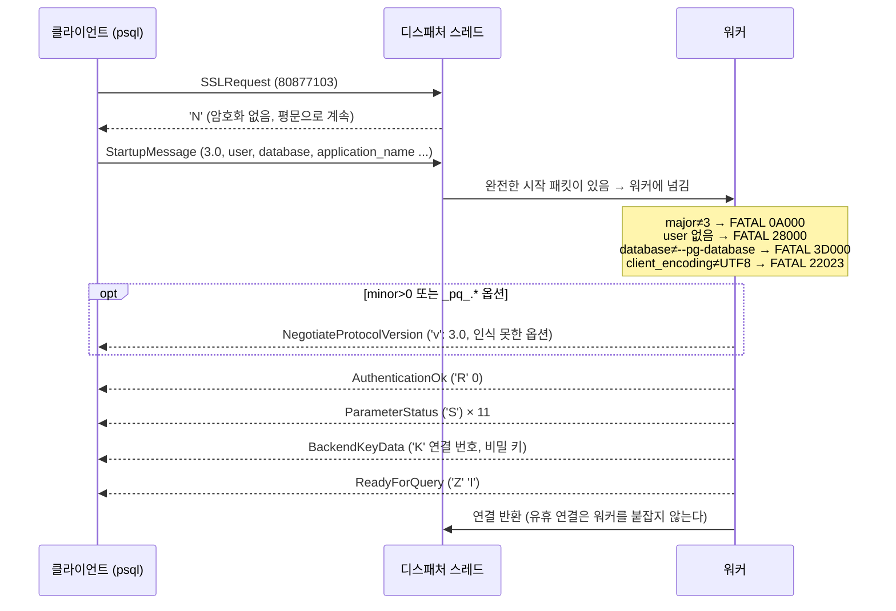
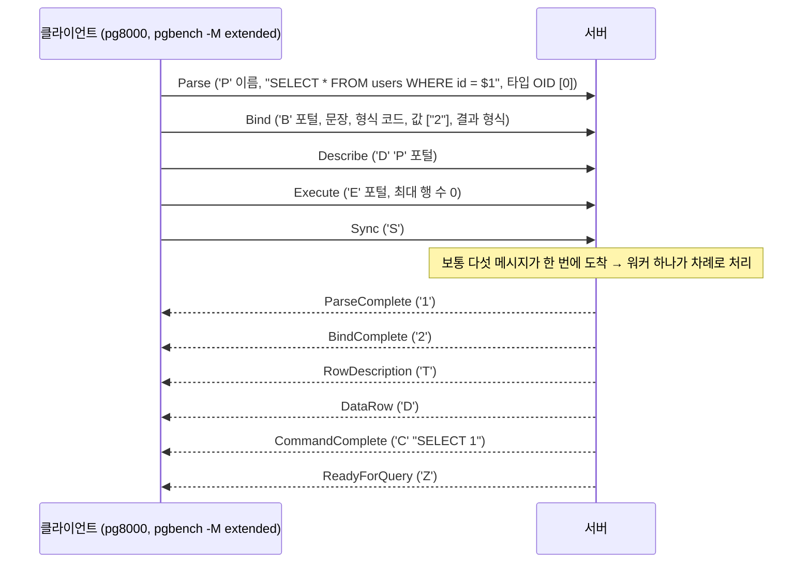
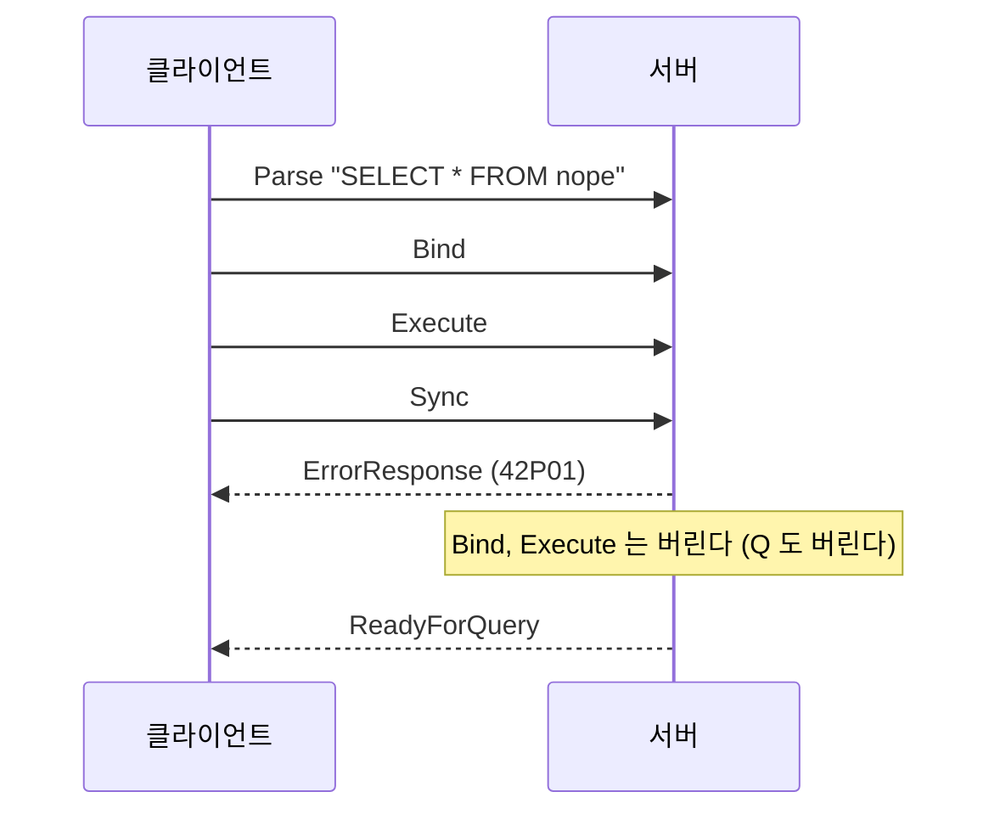
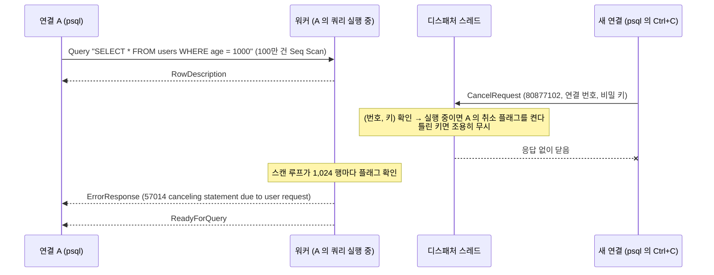

# PostgreSQL wire protocol (프론트엔드/백엔드 프로토콜 v3)

minidb 서버는 HTTP API 와 함께 PostgreSQL 프로토콜 v3 를 구현한다. psql, pgbench, pg8000, psycopg2/psycopg 가 그대로 접속한다.
같은 엔진, 같은 워커 풀, 같은 selectors 디스패처를 HTTP 와 함께 쓴다 (docs/server.md).

> **보안 경고**: 인증은 `trust` 다 (비밀번호를 묻지 않고 AuthenticationOk). TLS 도 없다 (SSLRequest 에 `N`).
> 기본 바인딩은 `127.0.0.1` 이다. `--host 0.0.0.0` 처럼 외부에 노출하지 말 것. 누구나 접속해 모든 테이블을 읽고 쓸 수 있다.

```sh
python -m minidb serve --db ./db --pg-port 5433            # PG 만
python -m minidb serve --db ./db                           # HTTP 8080 + PG 5433
psql -h 127.0.0.1 -p 5433 -U me -d minidb
```

코드:

| 모듈 | 역할 |
|---|---|
| `minidb/pgwire/messages.py` | 메시지 인코딩/디코딩, 타입별 최대 길이 검사 (바이트만 다룸) |
| `minidb/pgwire/protocol.py` | 연결 하나의 상태 기계: 시작 단계, 단순 쿼리, 확장 쿼리, 취소 플래그 (소켓 없음) |
| `minidb/pgwire/service.py` | 디스패처/워커 풀에 붙이는 처리기, 취소 요청 처리, 지표, 접속 로그 |
| `minidb/binder.py` | `$n` 파라미터 타입 추론과 값 채우기 (`ParamContext`, `bind_values`) |
| `minidb/engine.py` | `Database.prepare` / `execute_prepared` |

## 1. 메시지 흐름

### 1.1 시작 단계



ParameterStatus: `application_name`, `client_encoding` (UTF8), `server_version` (**16.0**), `server_encoding` (UTF8),
`DateStyle` (ISO, MDY), `integer_datetimes` (on), `standard_conforming_strings` (on), `TimeZone` (UTC),
`IntervalStyle` (postgres), `is_superuser` (on), `session_authorization` (시작 패킷의 user).
`server_version` 을 실제 PostgreSQL 형식으로 보내는 이유: psql 과 드라이버가 버전 번호로 쓸 기능을 고른다
(예: psycopg2 의 `conn.server_version` 은 160000).

### 1.2 단순 쿼리

```mermaid
sequenceDiagram
    participant C as 클라이언트
    participant S as 서버
    C->>S: Query ('Q') "INSERT ...; SELECT ...; SELEC 1; SELECT ..."
    S-->>C: CommandComplete "INSERT 0 2"
    S-->>C: RowDescription ('T')
    S-->>C: DataRow ('D') × n (만들어지는 대로 스트리밍)
    S-->>C: CommandComplete "SELECT n"
    S-->>C: ErrorResponse ('E': 42601, P=문자 위치)
    Note over S: 오류 뒤의 문장은 실행하지 않는다
    S-->>C: ReadyForQuery ('Z' 'I')
```

- 문장마다: 결과 행이 있으면 `T D* C`, 행이 없는 명령(INSERT, SET)은 `C`. 빈 쿼리 문자열은 EmptyQueryResponse(`I`).
- `SET application_name` 처럼 보고 대상 설정이 바뀌면 ReadyForQuery 앞에 ParameterStatus 를 보낸다.

### 1.3 확장 쿼리



- **Parse**: 문장 하나만 (`cannot insert multiple commands into a prepared statement`, 42601). 이름 있는 문장이
  이미 있으면 42P05. 이름 없는 문장("")은 새 Parse 가 덮어쓴다. 파싱·이름 해석·타입 검사·파라미터 타입 추론을 여기서 한다.
- **Bind**: 파라미터 수가 다르면 08P01 (`bind message supplies 2 parameters, but prepared statement "" requires 1`).
  형식 코드: 파라미터와 결과 모두 텍스트(0)/바이너리(1). 그 밖의 코드는 08P01. 값 변환 실패는 22P02/22003/22P03,
  NOT NULL 위반과 음수 LIMIT 도 여기서 검사한다.
- **Describe** `S`: ParameterDescription + RowDescription(결과 없으면 NoData). `P`: RowDescription(Bind 의 결과 형식 반영) 또는 NoData.
  없는 문장/포털은 26000/34000.
- **Execute**: 최대 행 수가 0 이면 전부, 아니면 그만큼 보내고 PortalSuspended(`s`). 다음 Execute 가 이어서 보낸다.
  포털은 결과 이터레이터와 스냅샷을 유지한다. 스냅샷 읽기는 락을 잡지 않으므로 포털이 열린 동안에도 다른 연결의 INSERT 가 막히지 않는다
  (포털은 열린 시점 이후의 행을 보지 않는다). INSERT 포털은 첫 Execute 에서 완료된다.
- **Sync**: ReadyForQuery. 이름 없는 포털은 여기서 닫는다 (이름 있는 포털은 Close 까지 산다).
- **Close**: CloseComplete. 없는 이름을 닫는 것은 오류가 아니다. **Flush**: 버퍼를 바로 보낸다. **Terminate**: 연결 종료.

### 1.4 오류 후 Sync 까지 무시



**왜 무시하는가**: 확장 쿼리의 클라이언트는 응답을 기다리지 않고 Parse/Bind/Execute/Sync 를 이어서 보낸다(파이프라이닝).
Parse 가 실패했는데 서버가 이어 온 Bind 를 처리하면, Bind 는 없는 문장(또는 **같은 이름의 예전 문장**)을 가리키게 되어
엉뚱한 쿼리를 실행할 수 있다. 서버가 Sync 까지 모두 버리면 클라이언트는 "오류 하나 + ReadyForQuery" 를 받고, Sync 를 경계로
양쪽이 다시 같은 상태가 된다. 그래서 Sync 는 "여기까지가 한 묶음" 이라는 동기화 지점이다. 단순 쿼리(Q)는 메시지 하나가
한 묶음이라 이 규칙이 필요 없다 (오류 뒤 바로 ReadyForQuery).

### 1.5 쿼리 취소



**왜 디스패처에서 처리하는가**: 취소는 별도 연결로 온다. 그 연결을 워커 큐에 넣으면, 모든 워커가 오래 걸리는 쿼리를 실행 중일 때
취소 요청도 큐에서 기다리게 된다. 취소가 가장 필요한 순간(서버가 바쁠 때)에 동작하지 않는 것이다. 취소 처리는
(번호, 키) 대조와 `threading.Event.set()` 하나라 디스패처 스레드에서 해도 짧다. 테스트(`test_cancel_works_when_all_workers_busy`)가
워커 1개를 긴 쿼리로 붙잡은 상태에서 취소가 동작하는 것을 확인한다.

세부 규칙:
- 연결 상태의 `_running` 과 취소 플래그는 락 아래에서 바꾼다. 문장 시작/끝에 플래그를 지우므로, 이전 문장에 늦게 도착한 취소가
  다음 문장을 죽이지 않고, 유휴 연결에 온 취소는 아무 일도 하지 않는다 (PostgreSQL 과 같다).
- 비밀 키는 `secrets.randbits(32)`, 비교는 `secrets.compare_digest`.
- **INSERT**: 배타 락 구간(파일 append + 인덱스 갱신)은 중간에 끊지 않는다. 취소는 락에 들어가기 **전에** 확인하고,
  쓰기가 끝난 INSERT 는 완료된 문장으로 본다. (락 구간 뒤에 확인해 57014 를 돌려주면, 이미 반영된 행에 대해 클라이언트가
  "실패" 를 받는다. 트랜잭션이 없어 되돌릴 수도 없으므로 완료로 보고하는 쪽이 정직하다.)
- libpq 17 의 새 취소 API 는 `sslmode=prefer` 면 SSLRequest 를 먼저 보낸 뒤 CancelRequest 를 보낸다. 디스패처는 시작 단계의
  SSLRequest/GSSENCRequest 에 `N` 을 답하고 다음 패킷을 계속 기다린다.

## 2. 메시지 바이트 형식

시작 단계 패킷은 `int32 길이 | int32 코드 | 내용` (타입 바이트 없음), 그 이후는 `byte1 타입 | int32 길이 | 내용`.
길이는 자기 자신(4바이트)을 포함하고 타입 바이트는 포함하지 않는다. 정수는 모두 빅엔디언. 문자열은 UTF-8 + `\0`.

### 2.1 프론트엔드 → 백엔드

| 메시지 | 타입 | 내용 | 최대 길이 |
|---|---|---|---|
| StartupMessage | (없음) | int32 196608 (3.0) · { 이름\0 값\0 } · \0 | 10,000 |
| SSLRequest | (없음) | int32 80877103 | 10,000 |
| GSSENCRequest | (없음) | int32 80877104 | 10,000 |
| CancelRequest | (없음) | int32 80877102 · int32 연결 번호 · int32 비밀 키 | 10,000 |
| Query | `Q` | 쿼리\0 | 1GB 미만 |
| Parse | `P` | 문장 이름\0 · 쿼리\0 · int16 n · int32 타입 OID × n | 1GB 미만 |
| Bind | `B` | 포털\0 · 문장\0 · int16 k · int16 형식 × k · int16 n · (int32 길이(-1=NULL) · 바이트) × n · int16 r · int16 형식 × r | 1GB 미만 |
| Describe | `D` | byte `S`/`P` · 이름\0 | 10,000 |
| Execute | `E` | 포털\0 · int32 최대 행 수 (0=전부) | 10,000 |
| Close | `C` | byte `S`/`P` · 이름\0 | 10,000 |
| Sync / Flush / Terminate | `S` / `H` / `X` | (없음) | 10,000 |

길이가 4 미만이거나 한도를 넘으면 FATAL 08P01 후 연결을 끊는다 (어디가 다음 메시지의 시작인지 더 이상 알 수 없으므로).
알 수 없는 타입 바이트도 FATAL 08P01 (`invalid frontend message type N`). 본문 형식이 틀린 메시지(문자열 끝 `\0` 없음 등)는
ERROR 08P01 이고 연결은 유지된다.

### 2.2 백엔드 → 프론트엔드

| 메시지 | 타입 | 내용 |
|---|---|---|
| AuthenticationOk | `R` | int32 0 |
| ParameterStatus | `S` | 이름\0 · 값\0 |
| BackendKeyData | `K` | int32 연결 번호 · int32 비밀 키 |
| NegotiateProtocolVersion | `v` | int32 지원 minor (0) · int32 n · 옵션 이름\0 × n |
| ReadyForQuery | `Z` | byte 상태 (항상 `I`: 트랜잭션 없음) |
| RowDescription | `T` | int16 n · { 이름\0 · int32 테이블 OID · int16 컬럼 번호 · int32 타입 OID · int16 타입 길이 · int32 typmod · int16 형식 } × n |
| DataRow | `D` | int16 n · { int32 길이 (-1 = NULL) · 바이트 } × n |
| CommandComplete | `C` | 태그\0 (`SELECT n`, `INSERT 0 n`, `SET`, `SHOW`, `EXPLAIN`) |
| EmptyQueryResponse | `I` | (없음) |
| ErrorResponse | `E` | { byte 코드 · 문자열\0 } · \0 — S 심각도, V 비지역화 심각도, C SQLSTATE, M, D, H, P |
| ParseComplete / BindComplete / CloseComplete | `1` / `2` / `3` | (없음) |
| ParameterDescription | `t` | int16 n · int32 타입 OID × n |
| NoData | `n` | (없음) |
| PortalSuspended | `s` | (없음) |

RowDescription 의 값: 테이블 컬럼이면 카탈로그의 테이블 oid 와 1부터의 컬럼 번호, EXPLAIN/SHOW 같은 계산 컬럼은 0, 0.
타입 OID 는 bigint 20 / text 25, 타입 길이는 int8 8 / text -1, typmod -1.

**ErrorResponse 의 P (위치)** 는 쿼리 문자열 기준 1부터의 **문자** 위치다 (바이트가 아님, PostgreSQL 과 같다).
한 Query 메시지에 문장이 여러 개면 메시지 전체 기준이다. psql 은 이 값으로 `LINE n:` 과 캐럿을 그린다
(실제 PostgreSQL 17 과 같은 출력임을 `tests/pgwire/psql/*.out` 으로 확인).

DataRow 형식: 텍스트(0)는 정수를 10진 문자열, 문자열을 UTF-8 로. 바이너리(1)는 int8 을 8바이트 부호 있는 정수, text 를 UTF-8 그대로.

## 3. 파라미터와 준비된 문장

`$1`, `$2` ... 는 리터럴이 올 수 있는 자리(VALUES 의 값, WHERE 비교의 상수 쪽, LIMIT)에 쓸 수 있다.
`$1 = id` 도 `id = $1` 로 정규화되고, 플래너는 `id = $1` 에 점 Index Scan 을 고른다 (EXPLAIN: `Index Cond: (id = $1)`).

**타입 추론** (Parse 에서): INSERT 값 → 대상 컬럼 타입, WHERE 비교 → 상대 컬럼 타입, LIMIT → bigint.
Parse 에 타입 OID 가 있으면 그것을 쓴다:

| 지정 OID | 처리 |
|---|---|
| 0, 705 (unknown) | 쓰인 자리에서 추론 (문자열 리터럴과 같다) |
| 20 int8, 23 int4, 21 int2 | BIGINT 계열. 텍스트 값은 그 타입의 입력 규칙 (int4 범위 밖이면 22003), 바이너리는 8/4/2 바이트 |
| 25 text, 1043 varchar | 문자열 계열. bigint 컬럼과 쓰이면 리터럴처럼 변환 (`'abc'` → 22P02) |
| 그 밖 | 0A000 |

정수 계열 파라미터와 text 컬럼 비교는 리터럴처럼 42883 (`operator does not exist: text = integer`).
추론할 수 없거나 쓰이지 않은 번호(`$2` 만 씀)는 42P18, 같은 번호가 두 타입으로 추론되면 42P08.
단순 쿼리와 CLI 에서 `$n` 은 42P02 `there is no parameter $1` (위치 포함).

### 3.1 준비된 문장이 파싱 비용을 줄이는 원리

Parse 는 렉싱 → 파싱 → 바인딩(이름 해석, 타입 검사, 파라미터 타입 추론)을 한 번 하고, 결과를 "값 자리에 `ParamRef` 가 있는 틀" 로
저장한다 (`PreparedStatement.bound`). Bind 는 틀을 복사하며 `ParamRef` 를 값으로 바꾸기만 한다 (`bind_values`). 그래서
`pgbench -M prepared` 는 문장을 한 번만 파싱하고, 이후 요청마다 Bind+Execute 만 한다. 카탈로그는 서버가 떠 있는 동안 바뀌지 않으므로
(읽기 전용) 틀을 계속 써도 안전하다. 효과는 docs/phase3-report.md §5 (pgbench simple vs prepared).

### 3.2 SQL 인젝션을 막는 원리

```python
# 위험: 값을 SQL 문자열에 이어 붙임 → name 이 "x' OR ..." 이면 SQL 의 구조가 바뀐다
cur.execute(f"SELECT * FROM users WHERE name = '{name}'")
# 안전: 구조(Parse)와 값(Bind)을 다른 메시지로 보낸다
conn.run("SELECT * FROM users WHERE name = :n", n=name)
```

확장 쿼리에서 SQL 텍스트는 Parse 메시지로 먼저 가고, 서버는 값을 보기 **전에** 문장 구조를 확정한다. 값은 Bind 메시지의
길이 접두 바이트열로 따로 오고, 렉서·파서를 거치지 않고 파라미터 타입의 입력 함수(정수 해석, UTF-8 해석)만 거친다.
그래서 값에 `'`, `;`, `--` 가 들어 있어도 그것은 그냥 문자열 값이다 (`test_insert_with_params_null_unicode_bigint` 가
`한글 'quote'` 를 그대로 저장하는 것을 확인). 값이 SQL 로 해석될 경로가 아예 없다.

(주의: psycopg2 처럼 클라이언트에서 값을 이스케이프해 문자열에 끼워 넣는 드라이버는 단순 쿼리를 쓴다. 이 경우의 안전성은
드라이버의 이스케이프에 달려 있다. `standard_conforming_strings = on` 을 알려 주는 이유도 드라이버가 올바르게 이스케이프하게 하려는 것이다.)

## 4. 서버 통합

- `python -m minidb serve --http-port N --pg-port M --pg-database minidb`. `--http-port` 만 주면 HTTP 만, `--pg-port` 만 주면 PG 만,
  둘 다 주면 둘 다. 둘 다 생략하면 HTTP 8080 + PG 5433 (실제 PostgreSQL 의 5432 와 겹치지 않게). `--port` 는 `--http-port` 의 별칭.
- 연결 하나 = 세션 하나 (`Session`: SET 값, application_name, 취소 플래그).
- 디스패처가 PG 연결의 수신 버퍼에 **완전한 메시지**가 생겼을 때만 워커에 넘긴다. 워커는 버퍼의 완전한 메시지를 모두 처리하고
  연결을 디스패처에 돌려준다. 유휴 연결과 반쯤 도착한 메시지는 워커를 붙잡지 않는다.
- 큐가 가득 차면: 시작 이후의 연결에는 ErrorResponse 53000 + ReadyForQuery (확장 쿼리면 Sync 까지 버린 뒤) 를 보내고 연결을 유지한다.
  시작 단계에서 가득 차면 FATAL 53300 후 종료. 최대 연결 수 초과도 FATAL 53300.
- 유휴 PG 연결의 타임아웃은 기본 없음 (PostgreSQL 기본과 같다. HTTP 의 60초를 쓰면 psql 세션이 1분마다 끊긴다).
  시작 패킷은 60초 안에 받아야 한다.
- 정상 종료 시 유휴 연결에 FATAL 57P01 `terminating connection due to administrator command` 를 보내고 닫는다.
- 접속 로그: `pg connection authorized: id= user= database= application_name= remote=`, `pg disconnection: ... session_time= queries=`.
- `/stats` 의 `pg`: 연결 수, 세션 수, 실행 중 쿼리 수, 취소 요청/전달 수, 큐 초과 거부 수.

## 5. 지원 / 미지원

| 지원 | 미지원 (범위 밖) |
|---|---|
| 프로토콜 3.0, 버전 협상 (minor>0, `_pq_.*`) | SSL/TLS, GSSAPI (요청에 `N`) |
| trust 인증 | 비밀번호, SCRAM, 그 밖의 인증 |
| 단순 쿼리 (여러 문장) | 트랜잭션 `BEGIN/COMMIT/ROLLBACK` (0A000) |
| 확장 쿼리 (이름 있는/없는 문장·포털, PortalSuspended) | COPY, LISTEN/NOTIFY, FunctionCall(`F`) |
| 텍스트/바이너리 형식 (int2/int4/int8/text/varchar) | 그 밖의 타입 OID |
| CancelRequest | `pg_catalog`, `information_schema` (psql 의 `\d` 는 오류) |
| SET/SHOW, ParameterStatus | SQL 수준 `PREPARE`/`EXECUTE` |

## 6. PostgreSQL 과 다르게 동작하는 부분

같은 시나리오를 실제 PostgreSQL 17 (`CREATE TABLE users (id bigint GENERATED ALWAYS AS IDENTITY PRIMARY KEY, name text, age bigint)`)
에 psql 로 실행해 비교했다. `basic`, `korean_null`, `on_error_stop` 시나리오는 **바이트 단위로 같았다**. 차이:

| 부분 | minidb | PostgreSQL | 이유 |
|---|---|---|---|
| `server_version` | `16.0` | `17.9 (Homebrew)` | 명세: 드라이버가 버전으로 기능을 고르므로 실제 PG 형식의 고정값 |
| `TimeZone` | `UTC` | 서버 설정 | 시간 타입이 없어 고정 |
| EXPLAIN | cost 없음, Bitmap Scan 없음, `Heap Fetch: sequential` | `(cost=… rows=… width=…)` | 비용 모델이 없다 (Phase 2) |
| 없는 컬럼 오류 | HINT 없음 | `HINT: Perhaps you meant to reference the column "users.name".` | 철자 추정(편집 거리)을 구현하지 않음 |
| `INSERT INTO users (id) …` | 위치(캐럿) 있음, HINT 없음 | 위치 없음, `HINT: Use OVERRIDING SYSTEM VALUE to override.` | OVERRIDING 을 지원하지 않으므로 그 힌트를 주지 않는다 |
| `SET nope = 1`, `SET x = maybe` 오류 | 위치(캐럿) 있음 | 위치 없음 | Phase 2 에서 오류 위치를 더 알려 주도록 정함 |
| 파라미터 값 오류 (NOT NULL, 음수 LIMIT) | Bind 에서 | Execute 에서 | 값 채우기(`bind_values`)를 Bind 에서 한 번 한다 |
| 확장 쿼리 결과의 RowDescription 형식 코드 | Describe `S` 는 항상 텍스트(0) | 같음 | — |
| `INSERT ... RETURNING` 을 max_rows 로 나눠 받기 | 삽입은 첫 Execute 에서 끝나고 행만 나눠 보냄 | 같음 | — |
| `client_encoding` | UTF8 계열만 (그 외 FATAL/ERROR 22023) | 여러 인코딩 변환 | 저장과 처리가 UTF-8 전용. 대화형 psql 은 로케일에서 정하므로 `LANG=C` 면 `SQL_ASCII` 를 보내 거절된다 → UTF-8 로케일 또는 `PGCLIENTENCODING=UTF8` |
| 알 수 없는 시작 패킷 파라미터 (`extra_float_digits` 등) | 무시 | GUC 로 적용 (모르면 FATAL) | JDBC 등 드라이버가 보내는 값을 거부하지 않으려고 |

psql 과 우리 CLI(`python -m minidb run`)의 차이: CLI 는 스크립트 **파일 기준** 줄 번호(`LINE 4:`)를, psql 은 서버가 아는 **문장 기준**
줄 번호(`LINE 1:`)를 보여 준다. psql 은 문장을 하나씩 보내므로 서버는 파일의 앞부분을 모른다. 그 밖의 결과 표와 오류 형식은 같다
(`tests/pgwire/test_psql.py::test_psql_matches_cli`, 줄 번호만 정규화해 비교). 이 비교에서 CLI 포매터의 버그 하나
(여러 줄 값이 있는 행에서 끝난 마지막 숫자 칸을 공백으로 채움)를 찾아 psql 과 같게 고쳤다.

## 7. 드라이버 호환

| 드라이버 | 확인 방법 | 결과 |
|---|---|---|
| psql 16/17 | `tests/pgwire/test_psql.py` (CI: ubuntu postgresql-client, macOS libpq) | 골든 6개 + CLI 일관성 5개 |
| pgbench 17 | `scripts/pgbench/run_pgbench.py` | simple / extended / prepared 모두 실패 0 |
| pg8000 1.31 (순수 파이썬) | `tests/pgwire/test_pg8000.py` | 통과. 3.14t 에서 import 후에도 GIL 꺼짐 |
| psycopg2 2.9.13 (libpq 17) | `scripts/compat/check_psycopg.py` (별도 프로세스) | 7/7 |
| psycopg 3.3.9 (libpq 18, binary) | 같은 스크립트 | 6/6 (서버 쪽 파라미터, prepare, 바이너리 결과) |

```sh
uv run --python 3.14.6+gil --with psycopg2-binary python scripts/compat/check_psycopg.py
uv run --python 3.14.6+gil --with "psycopg[binary]" python scripts/compat/check_psycopg.py
```

- psycopg2 를 **3.14t** 에서 import 하면 `GIL enabled after driver import: True` (C 확장이 free-threading 을 선언하지 않아
  인터프리터가 GIL 을 다시 켠다). 그래서 pytest 프로세스에서는 import 하지 않는다.
- DB-API 드라이버(pg8000.dbapi, psycopg2)는 기본이 트랜잭션 모드라 첫 문장 전에 `BEGIN` 을 보낸다 → 0A000.
  `autocommit = True` 로 쓴다 (pg8000.native 는 그대로 동작).
- pg8000 은 모든 파라미터를 unknown(705)로 보낸다 → 쓰인 자리에서 추론 (§3).
