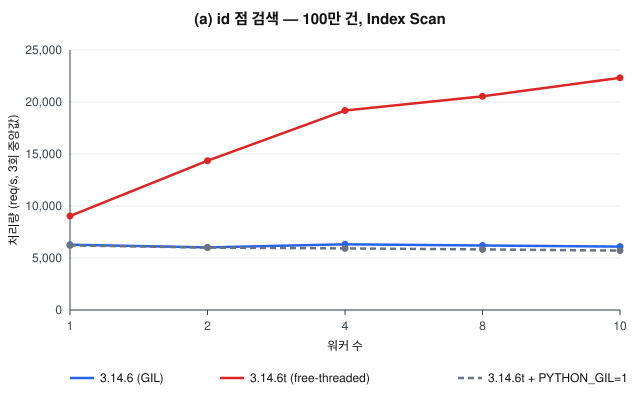
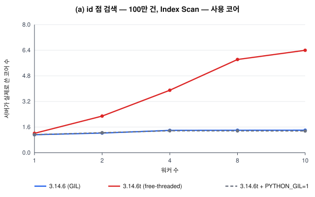
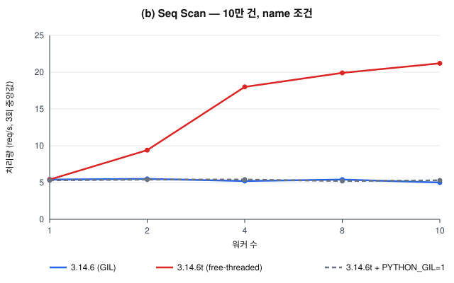
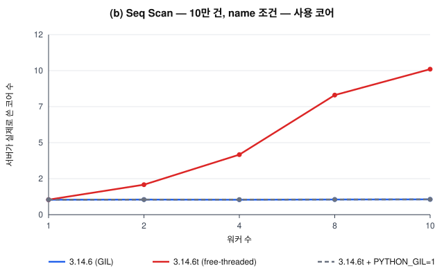
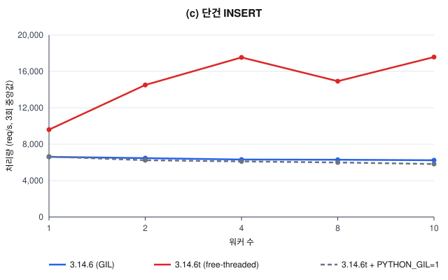
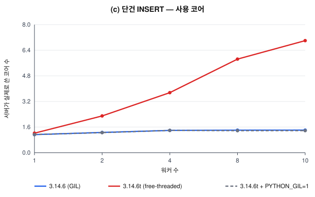
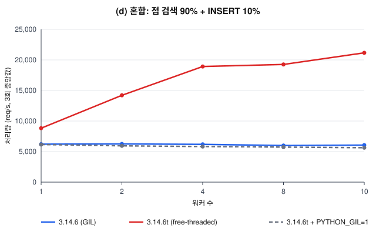
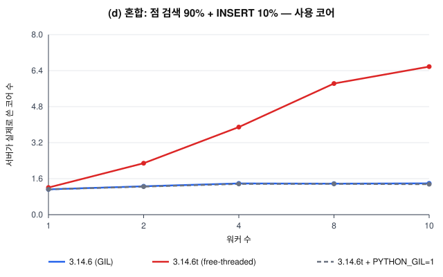

# Phase 3 리포트: 스레드 풀 서버의 병렬 성능 (3.14.6 +GIL vs 3.14.6t)

설계는 docs/server.md, 원시 결과는 `results/server/*.json` (180개), 집계는 `results/server/summary.json`.

## 1. 실험 설계

| 항목 | 값 |
|---|---|
| 머신 | Apple M4, 10코어 (**성능 코어 4 + 효율 코어 6**), 메모리 16 GB, macOS 15.1 |
| 서버 | `python -m minidb serve` 를 별도 프로세스로 실행, 워커 1 / 2 / 4 / 8 / 10 |
| 조건 | `gil` = 3.14.6 (+GIL 빌드), `ft` = 3.14.6t (`PYTHON_GIL=0`), `ft_gil1` = 3.14.6t 에 `PYTHON_GIL=1` (대조군) |
| 데이터 | users 100만 건(id 인덱스), people 10만 건. (조건, 워커 수) 조합마다 기준 DB 를 새로 복사 |
| 부하 생성기 | `scripts/loadgen.py`: 닫힌 루프, 프로세스 4개 × keep-alive 연결 8개 = 동시 요청 32. 서버와 **같은 머신** |
| 측정 | 워밍업 3초 뒤 10초 동안 완료된 요청. 3회 반복의 중앙값. 서버 CPU 는 `/stats` 의 getrusage(user+sys) 차이 ÷ 경과 시간 = 실제로 쓴 코어 수 |

워크로드:

| 이름 | 요청 | 성격 |
|---|---|---|
| point | `SELECT * FROM users WHERE id = <1..100만 무작위>` | 짧은 읽기 (Index Scan) |
| scan | `SELECT * FROM people WHERE name = '<무작위>'` | 긴 CPU 작업 (10만 건 Seq Scan, 요청당 약 0.2초) |
| insert | `INSERT INTO users (name, age) VALUES ('lg', 1)` | 짧은 쓰기 (테이블 배타 락) |
| mixed | point 90% + insert 10% | 읽기/쓰기 혼합 |

`ft_gil1` 은 같은 바이너리에서 GIL 만 다시 켠 것이다. `ft` 와 `ft_gil1` 의 차이는 순수하게 GIL 의 효과이고,
`gil` 과 `ft_gil1` 의 차이는 빌드(free-threading 빌드의 단일 스레드 오버헤드)의 효과다.

3회 반복의 편차는 모든 조건에서 1% 이내였다 (예: ft point 워커 4 = 19,209 / 19,169 / 19,185 req/s).

## 2. 결과

### 2.1 처리량 (req/s), 괄호 안은 서버가 쓴 코어 수

| 워크로드 | 조건 | 워커 1 | 2 | 4 | 8 | 10 |
|---|---|---|---|---|---|---|
| point | gil | 6,280 (1.12) | 6,022 (1.23) | 6,316 (1.39) | 6,198 (1.40) | 6,098 (1.40) |
| | **ft** | 9,035 (1.21) | 14,352 (2.28) | 19,185 (3.90) | 20,547 (5.82) | **22,332 (6.40)** |
| | ft_gil1 | 6,209 (1.13) | 6,002 (1.25) | 5,923 (1.37) | 5,826 (1.36) | 5,711 (1.36) |
| scan | gil | 5.4 (1.00) | 5.5 (1.01) | 5.2 (0.99) | 5.4 (1.01) | 5.0 (1.02) |
| | **ft** | 5.4 (1.00) | 9.4 (2.00) | 18.0 (4.00) | 19.9 (7.97) | **21.2 (9.70)** |
| | ft_gil1 | 5.3 (1.00) | 5.4 (1.00) | 5.4 (1.01) | 5.2 (1.01) | 5.3 (1.02) |
| insert | gil | 6,609 (1.13) | 6,469 (1.26) | 6,313 (1.39) | 6,289 (1.41) | 6,240 (1.41) |
| | **ft** | 9,597 (1.22) | 14,509 (2.29) | 17,540 (3.75) | 14,921 (5.85) | **17,578 (7.00)** |
| | ft_gil1 | 6,637 (1.13) | 6,236 (1.25) | 6,110 (1.39) | 5,995 (1.38) | 5,825 (1.38) |
| mixed | gil | 6,210 (1.13) | 6,245 (1.26) | 6,184 (1.39) | 5,990 (1.38) | 6,058 (1.39) |
| | **ft** | 8,823 (1.21) | 14,211 (2.29) | 18,924 (3.89) | 19,261 (5.83) | **21,162 (6.58)** |
| | ft_gil1 | 6,156 (1.13) | 5,942 (1.25) | 5,826 (1.37) | 5,732 (1.37) | 5,631 (1.35) |

### 2.2 워크로드별 최대 처리량

| 워크로드 | gil 최대 (워커, 코어) | ft 최대 (워커, 코어) | 배율 |
|---|---|---|---|
| point | 6,316 req/s (4, 1.39) | 22,332 req/s (10, 6.40) | 3.5× |
| scan | 5.5 req/s (2, 1.01) | 21.2 req/s (10, 9.70) | 3.9× |
| insert | 6,609 req/s (1, 1.13) | 17,578 req/s (10, 7.00) — 워커 4 에서 17,540 (3.75) | 2.7× |
| mixed | 6,245 req/s (2, 1.26) | 21,162 req/s (10, 6.58) | 3.4× |

### 2.3 지연 p99 (ms)

| 워크로드 | gil 워커 4 | ft 워커 4 | ft 워커 10 |
|---|---|---|---|
| point | 5.9 | 2.0 | 2.1 |
| scan | 6,200 | 1,826 | 1,804 |
| insert | 7.2 | 2.3 | 3.1 |
| mixed | 6.1 | 2.1 | 2.3 |

### 2.4 그래프

| | |
|---|---|
|  |  |
|  |  |
|  |  |
|  |  |

## 3. 해석

### 3.1 GIL 빌드는 워커 수와 무관하게 평평하다

`gil` 은 모든 워크로드에서 워커 1 → 10 의 처리량이 거의 같다 (point 6.0k–6.3k, scan 5.0–5.5).
파이썬 바이트코드를 실행할 수 있는 스레드는 한 번에 하나뿐이므로, 워커를 늘려도 일하는 코어는 늘지 않는다.
쓴 코어가 1.0 을 조금 넘는 것(1.1–1.4)은 소켓 send/recv 와 파일 pread 처럼 GIL 을 놓고 하는 시스템 콜이
겹치는 몫이다. 순수 CPU 작업인 scan 은 정확히 1.00 코어에 붙어 있다.

워커가 늘면 오히려 조금씩 떨어진다 (ft_gil1 point 6,209 → 5,711). GIL 을 주고받는 스레드가 많아져
전환 비용과 대기가 늘기 때문이다.

### 3.2 PYTHON_GIL=1 대조군: 차이는 빌드가 아니라 GIL 이다

`ft_gil1` 은 모든 칸에서 `gil` 과 ±5% 안에 있다. 같은 3.14t 바이너리라도 GIL 을 켜면 +GIL 빌드와 같은 모양이 된다.
따라서 `ft` 의 확장은 "free-threading 빌드가 원래 빠르다"가 아니라 **GIL 이 없어서** 생긴 것이다.
free-threading 빌드의 단일 스레드 오버헤드는 이 실험에서는 거의 보이지 않았다 (워커 1 에서 gil 6,280 vs ft_gil1 6,209).

### 3.3 3.14t 는 성능 코어 4개까지 거의 선형, 그 뒤는 완만

`ft` 는 워커 1 → 2 → 4 에서 point 9.0k → 14.4k → 19.2k, scan 5.4 → 9.4 → 18.0 으로 늘고,
쓴 코어도 1.2 → 2.3 → 3.9 로 워커 수를 따라간다. scan 은 워커 4 에서 3.3× (이상적 4×) 다.

워커 4 → 10 에서는 코어를 4.0 → 9.7 로 2.4배 쓰지만 scan 처리량은 18.0 → 21.2 (1.18배)뿐이다. 원인은 두 가지로 본다.

- **M4 의 코어 구성**: 성능 코어 4 + 효율 코어 6. 다섯 번째 스레드부터는 효율 코어에서 돌고, 효율 코어는 같은 파이썬
  코드를 훨씬 느리게 실행한다. "쓴 코어 수"는 늘지만 코어당 일의 양이 적다.
- **부하 생성기가 같은 머신에 있다**: 클라이언트 프로세스 4개가 같은 코어를 나눠 쓴다. point/insert 처럼 요청이
  짧은 워크로드에서는 부하 생성기도 초당 2만 개 요청을 만들고 응답을 파싱해야 하므로 서버와 코어를 다툰다.
  scan 은 요청이 초당 20개뿐이라 이 영향이 작은데도 같은 꺾임이 보이므로, 꺾임의 주원인은 효율 코어라고 판단했다.

점 검색이 워커 1 에서도 gil 6.3k vs ft 9.0k 로 차이가 나는 이유: 워커가 하나여도 서버에는 디스패처 스레드
(selectors 루프, accept, 유휴 연결 관리)가 따로 있다. GIL 빌드에서는 디스패처와 워커가 GIL 을 나눠 쓰고,
3.14t 에서는 실제로 동시에 돈다 (쓴 코어 1.21).

### 3.4 INSERT 는 왜 덜 확장되는가

INSERT 는 테이블 배타 락(RWLock 쓰기) 안에서 직렬화된다. 그런데도 ft 에서 워커 1 → 4 에 9.6k → 17.5k (1.8×)
로 늘어난다. 락이 감싸는 것은 `append_many` (레코드 직렬화 + 파일 쓰기 + 인덱스 삽입)뿐이고, 그 바깥의
HTTP 파싱, SQL 렉싱/파싱, 바인딩, 결과 JSON 생성, 소켓 송수신은 병렬로 돌기 때문이다.
암달의 법칙대로 직렬 구간의 비율이 상한을 정한다. 워커 4 에서 17.5k req/s 이면 요청당 약 57 µs 인데,
이 중 락 안의 구간이 차지하는 몫 이상으로는 처리량이 늘 수 없다.

워커 8 에서 14.9k 로 떨어졌다가 워커 10 에서 17.6k 로 돌아오는 굴곡은 3회 반복 모두 같은 값(14,968 / 14,871 / 14,920)으로
재현됐다. 원인은 확인하지 못했다. 가설은 락을 쥔 스레드가 효율 코어에 배치되면 임계 구역이 길어지고 그동안
나머지 워커가 모두 기다리는 것인데, 스레드-코어 배치를 고정해 보는 실험(macOS 에서는 어려움)은 하지 않았다.

mixed (쓰기 10%) 는 point 와 거의 같은 곡선이다. 쓰기 락이 잡혀 있는 시간이 짧아서 읽기가 막히는 시간이 작다.

### 3.5 GIL convoy 효과: 스트레스 테스트 26.2초 vs 0.7초

`tests/test_stress.py::test_http_concurrent_inserts_and_snapshot_reads --stress-scale 10` 은 GIL 빌드에서 26.2초,
3.14t 에서 0.7초 걸렸다. 정확성은 둘 다 통과했다. 읽기 스레드가 결과가 큰 `SELECT id FROM users`(행 수가 계속
늘어남)를 실행하는 동안 GIL 을 오래 쥐고 있고, INSERT 요청을 처리하는 스레드는 소켓 호출 때마다 GIL 을 놓았다가
다시 얻으려고 GIL 전환 간격(기본 5 ms)만큼 기다린다. 짧은 I/O 작업이 긴 CPU 작업 뒤에 줄을 서는 전형적인
convoy 효과다. 3.14t 에서는 기다릴 GIL 이 없다. 위 표의 scan 지연(gil p99 6.2초 vs ft 1.8초)도 같은 현상의
다른 얼굴이다: GIL 빌드에서는 동시 요청 32개가 한 코어를 나눠 쓰므로 요청 하나가 끝나는 데 오래 걸린다.

### 3.6 실험의 한계

- 부하 생성기와 서버가 같은 10코어 머신을 나눠 쓴다. 부하 생성기의 CPU 사용량은 측정하지 않았으므로,
  point/insert 의 워커 8–10 수치는 머신 전체가 포화된 상태의 값일 수 있다. 별도 머신에서 부하를 걸면 더 높을 수 있다.
- 부하 생성기는 3.14.6 (+GIL) 으로 실행했다 (`loadgen_runtime` 필드). 프로세스 4개라 GIL 의 영향은 받지 않는다.
- 동시 요청 수는 32 로 고정했다. 워커 10 이면 큐에 항상 일이 있고, 503 거절은 모든 실행에서 0건이었다.
- 루프백 연결이라 네트워크 지연이 없다. 실제 네트워크에서는 요청당 고정 비용이 커져 처리량 차이가 줄어든다.
- 측정은 10초 × 3회다. 3.14t 의 메모리 사용량이나 장시간 운영 시 동작은 보지 않았다.

## 4. 결론

- 이 서버의 요청 처리는 대부분 파이썬 CPU 작업(파싱, 실행, JSON)이라 GIL 빌드에서는 워커 수가 처리량을 바꾸지 못한다.
- 3.14t 는 성능 코어 4개까지 거의 선형으로 확장되고, 최대 처리량은 GIL 빌드의 2.7–3.9배다.
- 같은 바이너리에서 GIL 만 켜면(`PYTHON_GIL=1`) 확장이 사라진다. 차이를 만든 것은 GIL 이다.
- 쓰기는 테이블 배타 락 때문에 읽기보다 덜 확장되지만, 락 바깥의 일이 크기 때문에 직렬화된 구간만큼만 손해를 본다.

## 5. PostgreSQL 프로토콜: pgbench 결과 (simple vs extended vs prepared, HTTP vs PG)

같은 서버에 PostgreSQL wire protocol 리스너(docs/pg-protocol.md)를 붙이고, PostgreSQL 공식 도구 pgbench 17.9 의
사용자 정의 스크립트 모드로 부하를 걸었다. 원시 결과 `results/pgbench/*.json` (243개, pgbench 출력 원문 포함), 집계 `results/pgbench/summary.json`.

| 항목 | 값 |
|---|---|
| 명령 | `pgbench -n -h 127.0.0.1 -p <port> -U bench -d minidb -c 32 -j 4 -T 10 -M <mode> -f ...` |
| 워크로드 | point: `\set id random(1, 1000000)` + `SELECT * FROM users WHERE id = :id`, insert: `INSERT INTO users (name, age) VALUES ('bench', 30)`, mixed: point@9 + insert@1 |
| 모드 | simple (`Q` 하나), extended (매번 Parse+Bind+Describe+Execute+Sync), prepared (Parse 는 연결마다 한 번, 이후 Bind+Execute+Sync) |
| 조건 | gil / ft / ft_gil1 (§1 과 같다) × 워커 1, 4, 10 |
| 측정 | 설정마다 3초 워밍업 뒤 10초 × 3회의 중앙값. 서버 CPU 는 HTTP `/stats` 의 getrusage 차이 |

243회 모두 실패한 트랜잭션 0. 반복 간 편차는 대부분 5% 이내였지만 최대 22% (ft, insert, simple, 워커 4) 로 §2 의
HTTP 부하 생성기(1% 이내)보다 컸다. pgbench 클라이언트 스레드 4개가 서버와 같은 성능 코어를 다투는 영향으로 본다.

### 5.1 처리량 (tps), 괄호 안은 서버가 쓴 코어 수

| 워크로드 | 조건 | 모드 | 워커 1 | 4 | 10 |
|---|---|---|---|---|---|
| point | gil | simple | 8,160 (1.13) | 7,404 (1.22) | 7,259 (1.21) |
| | | extended | 6,770 (1.11) | 6,145 (1.18) | 5,869 (1.18) |
| | | prepared | **10,686** (1.17) | 9,263 (1.27) | 8,917 (1.26) |
| | ft | simple | 10,544 (1.28) | 20,752 (3.87) | 20,961 (6.24) |
| | | extended | 7,574 (1.18) | 17,987 (3.95) | 20,148 (6.52) |
| | | prepared | 15,429 (1.38) | **23,793** (3.71) | 21,383 (5.87) |
| | ft_gil1 | simple | 7,428 (1.12) | 6,312 (1.17) | 6,307 (1.16) |
| | | extended | 6,088 (1.09) | 5,301 (1.15) | 5,305 (1.15) |
| | | prepared | 9,415 (1.14) | 7,573 (1.20) | 7,708 (1.21) |
| insert | gil | simple | 9,071 (1.14) | 8,169 (1.24) | 7,620 (1.23) |
| | | extended | 7,681 (1.12) | 7,012 (1.21) | 6,736 (1.22) |
| | | prepared | **14,533** (1.22) | 11,447 (1.38) | 11,791 (1.37) |
| | ft | simple | 11,928 (1.30) | 16,938 (3.47) | 17,172 (6.44) |
| | | extended | 9,794 (1.24) | 16,282 (3.67) | 17,091 (6.88) |
| | | prepared | **21,809** (1.54) | 18,926 (3.18) | 18,310 (6.64) |
| | ft_gil1 | simple | 8,243 (1.13) | 6,921 (1.19) | 6,995 (1.18) |
| | | extended | 7,080 (1.11) | 6,035 (1.17) | 5,956 (1.18) |
| | | prepared | 12,690 (1.19) | 9,826 (1.28) | 9,420 (1.30) |
| mixed | gil | simple | 8,115 (1.13) | 6,689 (1.20) | 7,182 (1.22) |
| | | extended | 6,720 (1.11) | 5,748 (1.18) | 6,075 (1.19) |
| | | prepared | **10,566** (1.17) | 8,500 (1.25) | 9,098 (1.29) |
| | ft | simple | 10,210 (1.27) | 18,656 (3.72) | 20,095 (6.30) |
| | | extended | 7,707 (1.18) | 17,774 (3.92) | 18,840 (6.41) |
| | | prepared | 15,106 (1.37) | **23,844** (3.72) | 20,603 (5.97) |
| | ft_gil1 | simple | 7,378 (1.12) | 6,305 (1.18) | 6,290 (1.17) |
| | | extended | 6,134 (1.10) | 5,310 (1.16) | 5,296 (1.16) |
| | | prepared | 9,434 (1.14) | 7,713 (1.23) | 7,706 (1.22) |

평균 지연(ms)은 동시 32 의 닫힌 루프라 대략 32 / tps 다. 예: ft point prepared 워커 4 는 1.34 ms, gil 은 3.46 ms.

### 5.2 prepared 가 파싱 비용을 얼마나 줄이는가 (simple 대비)

| 조건 | 워크로드 | 워커 1 | 워커 4 | 워커 10 |
|---|---|---|---|---|
| gil | point | +31% | +25% | +23% |
| gil | insert | +60% | +40% | +55% |
| ft | point | +46% | +15% | +2% |
| ft | insert | +83% | +12% | +7% |

- 코어 하나에 묶인 경우(GIL 빌드 전체, 3.14t 워커 1)에는 요청당 CPU 시간이 그대로 처리량을 정한다. prepared 는 요청마다 하던
  렉싱 → 파싱 → 바인딩(이름 해석, 타입 검사)을 빼고 값 채우기(`bind_values`)만 하므로 point 에서 23–46%, insert 에서 40–83% 빨라진다.
  insert 의 이득이 더 큰 것은 INSERT 문장이 더 길고(컬럼 목록 + VALUES) 바인딩에서 대입 변환과 NOT NULL 검사까지 하기 때문이다.
- 3.14t 워커 4–10 에서는 이득이 2–15% 로 줄어든다. 이때는 서버가 아니라 머신이 한계다: 서버가 3.7–6.6 코어를 쓰고, pgbench 스레드 4개와
  성능 코어 4개를 나눠 쓴다 (§3.3 의 효율 코어 문제와 같다). 요청당 비용이 줄어도 코어가 남지 않으면 처리량이 늘지 않는다.
- **extended 는 simple 보다 느리다** (gil point 워커 1: 6,770 vs 8,160). pgbench `-M extended` 는 쿼리마다 Parse(이름 없는 문장) +
  Bind + Describe + Execute + Sync 다섯 메시지를 보낸다. 파싱은 simple 과 똑같이 매번 하면서, 메시지 해석과 준비된 문장·포털 객체
  생성이 더해진다. 확장 쿼리의 이득은 "Parse 를 한 번만" 하는 prepared 에서만 나온다.

### 5.3 insert 는 워커 1 이 가장 빠르다

insert prepared 의 최고 처리량은 두 빌드 모두 **워커 1** 이다 (gil 14,533, ft 21,809). INSERT 는 테이블 배타 락 안에서
직렬화된다. prepared 로 락 바깥의 일(파싱·바인딩)이 줄어들면 요청 시간 중 락 구간의 비중이 커지고, 워커를 늘려도 락 앞에서 기다리는
시간만 늘어난다. 거기에 `threading.Condition` 기반 RWLock 의 대기/깨우기 비용이 더해져 워커 4 이상에서 오히려 낮아진다 (ft 21,809 → 18,926).
simple 은 락 바깥의 파싱이 커서 여전히 워커를 늘리는 이득이 있다 (ft 11,928 → 17,172). 암달의 법칙이 요청당 비용 구성에 따라 다르게 나타나는 예다.

### 5.4 HTTP 와 비교 (같은 워크로드, 동시 32)

| 조건 | 워크로드 | HTTP (§2, loadgen) | PG simple | PG prepared |
|---|---|---|---|---|
| gil 워커 4 | point | 6,316 | 7,404 (1.17×) | 9,263 (1.47×) |
| gil 워커 4 | insert | 6,313 | 8,169 (1.29×) | 11,447 (1.81×) |
| ft 워커 4 | point | 19,185 | 20,752 (1.08×) | 23,793 (1.24×) |
| ft 워커 10 | point | 22,332 | 20,961 (0.94×) | 21,383 (0.96×) |
| ft 최대 | insert | 17,578 (워커 10) | 17,172 (워커 10) | 21,809 (워커 1) |
| ft 최대 | mixed | 21,162 (워커 10) | 20,095 (워커 10) | 23,844 (워커 4) |

- 코어 하나에 묶인 GIL 빌드에서는 PG 프로토콜이 HTTP 보다 17–29% (simple), 47–81% (prepared) 빠르다. 같은 SQL 을 실행하지만
  요청 하나에 드는 서버 쪽 일이 다르다: HTTP 는 요청 줄·헤더 파싱, Content-Type 검사, 결과 JSON 직렬화(`json.dumps`)가 있고,
  PG 는 길이 접두 프레임을 자르고 DataRow 를 `struct` 로 만드는 정도다.
- 3.14t 워커 10 에서는 차이가 거의 없거나 PG 가 조금 낮다. 둘 다 머신이 포화된 영역이고, 클라이언트가 다르다(HTTP 는 파이썬 loadgen
  4 프로세스, PG 는 C 로 된 pgbench 4 스레드). 클라이언트의 CPU 사용량을 따로 재지 않았으므로 이 영역의 차이는 해석하지 않는다.
- 정리하면, 요청당 비용이 처리량을 정하는 영역(GIL 빌드, 적은 워커)에서는 "프로토콜의 가벼움"과 "파싱 생략"이 그대로 처리량으로 나타나고,
  코어가 한계인 영역(3.14t, 많은 워커)에서는 둘 다 머신 포화에 가려진다.

### 5.5 다시 확인된 것

- 모든 모드·워크로드에서 ft_gil1 은 gil 과 같은 모양(워커를 늘려도 평평하거나 감소)이다. §3.2 의 결론(차이는 GIL 때문)이
  프로토콜이 바뀌어도 그대로다.
- GIL 빌드에서 워커 1 이 가장 빠른 것도 §3.1 과 같다: GIL 을 주고받는 스레드가 늘수록 전환 비용이 커진다.
