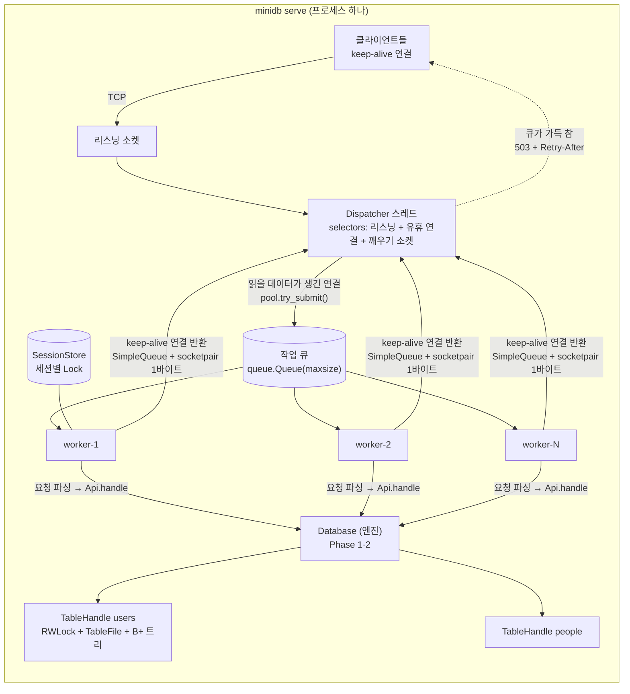

# minidb 서버 (Phase 3): 동시성 제어, 스레드 풀, HTTP API

`python -m minidb serve --db <dir>` 는 Phase 1·2 엔진(`Database`)을 그대로 내부 엔진으로 쓰는 HTTP/1.1 API 서버다.
표준 라이브러리만 쓰고, `http.server`·`socketserver`·`ThreadPoolExecutor` 없이 스레드 풀과 HTTP 처리를 직접 구현했다.

## 1. 아키텍처



| 구성 요소 | 모듈 | 역할 |
|---|---|---|
| HTTP 파서 | `minidb/server/http.py` | 요청 줄·헤더·Content-Length 본문, keep-alive 규칙, 크기 한계. 순수 함수 |
| 워커 풀 | `minidb/server/pool.py` | 고정 크기 스레드 N 개 + 크기 제한 큐. `try_submit` 은 큐가 차면 즉시 False |
| 디스패처 | `minidb/server/dispatcher.py` | selectors 로 연결 감시, 요청이 온 연결만 워커에 배정, 연결 한계·유휴/수신 타임아웃 |
| API | `minidb/server/api.py` | 엔드포인트, `/query` 실행과 JSON 변환, HTTP 세션 |
| 서버 | `minidb/server/server.py` | 조립, 시작, 신호 처리, 정상 종료 |
| 엔진 | `minidb/engine.py`, `minidb/table.py`, `minidb/concurrency.py` | 스레드 안전한 Database, 테이블별 RWLock, 스냅샷 읽기 |
| PG 프로토콜 | `minidb/pgwire/` | PostgreSQL wire protocol 리스너 (docs/pg-protocol.md) |

**리스너 여러 개**: 디스패처 하나가 HTTP 리스너와 PostgreSQL 프로토콜 리스너(`--pg-port`)를 함께 감시한다
(`Dispatcher.add_listener`). 두 프로토콜의 연결은 같은 selector, 같은 워커 풀, 같은 최대 연결 수, 같은 엔진을 쓴다.
차이는 워커에 넘기는 시점이다: HTTP 연결은 읽을 데이터가 생기면 바로 넘기고 워커가 요청을 읽는 반면,
PG 연결은 프로토콜 처리기(`ConnectionProtocol.on_readable`)가 디스패처 스레드에서 데이터를 읽어 **완전한 메시지가 생겼을 때만**
넘긴다. 그래서 반쯤 도착한 PG 메시지는 워커를 붙잡지 않고, 취소 요청(CancelRequest)은 워커 없이 디스패처에서 바로 처리된다.

## 2. 요청 생명주기

1. **accept** (디스패처): 새 연결을 받으면 열린 연결 수를 확인한다. `--max-connections` 를 넘으면 503(SQLSTATE 53300)
   응답 후 닫는다. 아니면 selector 에 **읽기 대기**로 등록한다. 이때 연결은 어떤 워커도 붙잡지 않는다.
2. **배정** (디스패처): 연결에 읽을 데이터가 생기면 selector 에서 빼고 `pool.try_submit(serve(conn))`.
   큐가 가득 차 있으면 기다리지 않고 바로 **503 + `Retry-After: 1`** (SQLSTATE 53000) 후 닫는다(백프레셔, §5).
3. **처리** (워커): 연결의 수신 버퍼에 완전한 요청이 생길 때까지 읽는다(요청 수신 타임아웃, 기본 10초: 넘으면 408).
   파싱 → `Api.handle` → 엔진 실행 → JSON 응답을 보낸다. 접근 로그를 한 줄 남긴다.
4. **파이프라이닝**: 응답 후 수신 버퍼에 다음 요청이 이미 있으면(한 번에 두 요청이 온 경우) 같은 워커가 차례로 처리한다.
   응답 순서 = 요청 순서.
5. **반환** (워커 → 디스패처): 버퍼가 비었고 keep-alive 면 연결을 `SimpleQueue` 에 넣고 `socketpair` 에 1바이트를 써서
   select 중인 디스패처를 깨운다. 디스패처는 연결을 다시 selector 에 등록한다(1번 상태로).
   `Connection: close`, HTTP/1.0 기본, 프로토콜 오류, 서버 종료 중이면 응답 후 닫는다.
6. **유휴 정리** (디스패처): 최대 1초 간격으로 `--idle-timeout`(기본 60초) 넘게 논 연결을 닫는다.

**연결 소유권**: 연결 객체는 언제나 정확히 한 곳에만 있다 — (a) 디스패처의 selector, (b) 처리 중인 워커, (c) 반환 큐.
그래서 연결별 상태(수신 버퍼 등)에는 락이 없다. 넘겨줄 때 큐(내부 락)가 메모리 가시성을 보장한다.
여러 스레드가 함께 쓰는 것(열린 연결 수, 종료 플래그, 거부 카운터)은 디스패처의 락으로 보호한다.

**왜 디스패처 + 워커인가**: 연결마다 스레드를 붙이면 놀고 있는 keep-alive 연결이 스레드를 하나씩 차지한다.
여기서는 놀고 있는 연결이 selector 에만 있으므로 워커 수(예: 8)보다 훨씬 많은 연결(예: 1024)을 유지할 수 있고,
워커는 실제로 할 일이 있는 요청만 처리한다.

## 3. 잠금 설계

| 대상 | 락 | 범위 |
|---|---|---|
| 테이블 핸들 캐시 | `Database._tables_lock` (Lock) | 처음 열 때만. 이중 확인: 열린 핸들은 락 없이 dict 에서 꺼낸다 |
| 테이블 데이터 + 인덱스 | 테이블마다 `RWLock` (쓰기 우선) | SELECT: 스냅샷을 잡는 동안만 공유. INSERT: append + 인덱스 갱신 전체를 배타 |
| 카탈로그 | 없음 | 생성 시 한 번 로드한 뒤 읽기 전용 |
| 세션 | 연결/HTTP 세션마다 하나, 세션별 Lock | 같은 HTTP 세션의 동시 요청은 직렬화. 세션은 스레드 사이에 공유하지 않는다 |
| SessionStore | Lock | 생성·조회·삭제·만료 |
| 풀 지표, 디스패처 카운터, 로그 | 각자의 Lock | `+=` 를 원자적이라 가정하지 않는다 (3.14t 에는 GIL 이 없다) |

### 3.1 RWLock (`minidb/concurrency.py`)

`threading.Condition` 하나로 구현한다. 상태 `readers`(읽기 보유 수), `writer`(쓰기 보유 스레드),
`waiting_writers`(쓰기 대기 수)는 조건 변수의 락 아래에서만 바꾼다.

```
acquire_read : while writer or waiting_writers: wait()      ← 쓰기 우선: 줄 선 쓰기가 있으면 새 읽기는 기다림
               readers += 1
release_read : readers -= 1; if readers == 0: notify_all()
acquire_write: waiting_writers += 1
               while writer or readers: wait()
               waiting_writers -= 1; writer = me             (시간 초과로 포기하면 notify_all: 막혀 있던 읽기를 풀어 줌)
release_write: writer = None; notify_all()
```

- **쓰기 우선(writer preference)**: 읽기만 우선하면 읽기가 계속 겹쳐 들어오는 동안 `readers` 가 0 이 되는 순간이 오지 않아
  쓰기가 영원히 기다린다(기아). 쓰기가 줄을 서는 순간 새 읽기를 막으면, 이미 들어온 읽기만 끝나면 쓰기가 들어간다.
  minidb 에서는 읽기 구간이 "스냅샷 잡기"뿐이라 매우 짧으므로, 반대로 읽기가 굶을 걱정도 거의 없다.
- **재진입 미지원**: 같은 스레드가 읽기를 가진 채 다시 읽기를 요청하면, 그 사이 쓰기가 줄을 섰을 때 교착된다
  (내 두 번째 읽기는 쓰기를 기다리고, 쓰기는 내 첫 번째 읽기를 기다림). 디버그 모드(기본: `python -O` 가 아닐 때)에서는
  보유 스레드를 추적해 중첩 획득을 즉시 `AssertionError` 로 잡는다. 엔진의 모든 락 구간은 다른 락을 부르지 않도록 짰다.
- **시간 제한**: `read_locked(timeout)` / `write_locked(timeout)` 이 시간을 넘기면 `LockNotAvailable` (55P03,
  `could not obtain lock on relation "users"`). 서버 기본값은 `--lock-timeout 30` 초.

### 3.2 스냅샷 읽기 (append-only 를 이용한 문장 단위 스냅샷)

**원리**: 데이터 파일은 append-only 다. 한 번 쓰인 바이트는 다시 바뀌지 않는다. 그래서 어떤 시점의 파일 끝 offset `E` 를
기록해 두면, `[헤더, E)` 구간은 그 뒤 언제 읽어도 같은 내용이다. SELECT 는

1. 테이블 공유 락을 **잠깐** 잡고 스냅샷을 기록한다:
   - Seq Scan: `E = file.size`
   - 점 Index Scan: `offset = tree.search(k)` 와 `E`
   - 범위 Index Scan: 하한 이상인 첫 키의 `offset` 과 `E`
2. 락을 푼다.
3. 락 없이 읽는다: `scan(end_offset=E)`, `read_at(offset)` (`offset < E` 일 때), `scan_from(offset, E)`.

INSERT 는 배타 락 안에서 `append_many`(반환 시점에 OS 로 flush 완료) → 인덱스 insert → 락 해제. **락이 풀리는 시점이
커밋 시점**이다. SELECT 하나는 시작할 때 잡은 스냅샷 하나만 쓴다(한 문장은 테이블 하나를 한 번 스캔한다).
EXPLAIN ANALYZE 도 같은 계획 노드를 실행하므로 같은 규칙을 따른다.

**왜 올바른가**:

1. *E 이전의 모든 레코드는 완전히 쓰였다.* `_end` 는 `append_many` 가 쓰기와 `flush()` 를 마친 **뒤에**, 배타 락 안에서만
   갱신된다. 공유 락은 배타 락과 겹치지 않으므로 공유 락 안에서 읽은 `_end` 는 어떤 append 의 중간 값일 수 없다.
   flush 가 끝났으므로 다른 파일 핸들(스캔용 새 fd, `read_at` 의 pread)로도 그 바이트가 보인다(저장 계층 불변식 (a)).
2. *E 이전의 바이트는 바뀌지 않는다.* append-only. 잘린 꼬리 복구(truncate)는 테이블을 열 때만, 핸들을 공유하기 전에 일어난다.
3. *인덱스와 E 가 서로 맞는다.* 인덱스 갱신도 같은 배타 구간 안에 있으므로, 공유 락 안에서 본 트리에 있는 키는 모두
   `offset < E` 이고, `E` 이전의 비삭제 레코드는 모두 트리에 있다. 그래서 인덱스 경로와 Seq Scan 경로가 같은 스냅샷에서
   같은 행 집합을 본다(차등 테스트가 동시성 없는 상황에서 이를 확인하고, 스트레스 테스트가 동시 상황에서 확인한다).
4. *커밋 순서 = id 순서.* id 할당과 append 가 배타 구간 안에서 직렬화되므로, 어떤 스냅샷이든 보이는 행은 정확히
   "id 1..k" 의 연속 구간(커밋된 접두사)이다. 스냅샷은 시간에 따라 길어지기만 한다.

**읽기 경로의 공유 가변 상태 점검** (락 밖에서 읽어도 되는가):

| 경로 | 쓰는 공유 상태 | 결론 |
|---|---|---|
| `TableFile.scan` / `scan_from` / `records` | 호출마다 **새 fd** 를 열고 그 fd 의 파일 위치만 움직인다. 인스턴스 속성은 바꾸지 않는다 | 안전 |
| `TableFile.read_at` | 공용 읽기 fd 를 쓰지만 `os.pread` 라 파일 위치를 공유하지 않는다. `_end`/`_next_id` 를 읽기만 한다 | 안전 (`offset < E` 를 호출자가 보장) |
| `RecordCodec.decode` | 생성 후 불변인 튜플들만 읽는다. 캐시 없음 | 안전 |
| 쓰기 버퍼 (`_writer`) | 읽기 경로는 쓰기 버퍼를 건드리지 않는다. append 가 반환 전에 flush 하므로 읽기가 버퍼를 볼 필요도 없다 | 안전 |
| `BPlusTree.search` / `range` | 읽기 전용, 캐시 없음. 단 insert 와 동시에 돌면 노드 배열이 바뀌므로 **공유 락 안에서만** 부른다 | 공유 락 안에서만 |
| `Catalog.get` | 생성 시 로드한 dict 를 읽기만 | 안전 |
| `QueryResult`, 계획 노드, Session | 요청마다 새로 만든다 | 공유 안 함 |

바꾼 것: 인덱스 재구성(무효화 후)이 전에는 파일을 닫고 다시 열었다. 락 밖에서 같은 `TableFile` 로 `read_at` 하는 스캔이
있을 수 있으므로, 이제는 배타 락 안에서 **열린 파일을 그대로 다시 훑어** 트리만 새로 만든다.

### 3.3 PostgreSQL MVCC 와의 비교

| | PostgreSQL | minidb |
|---|---|---|
| 스냅샷 단위 | 트랜잭션 또는 문장 (격리 수준에 따라) | 문장 (트랜잭션 없음) |
| 스냅샷 내용 | xmin/xmax/진행 중 xid 목록. 튜플마다 xmin/xmax 로 가시성 판단 | 파일 끝 offset 하나 |
| 왜 그렇게 단순해도 되나 | UPDATE/DELETE 가 기존 튜플을 바꾸거나 새 버전을 아무 데나 쓴다 | append-only + 순차 id: 커밋 순서 = 파일 순서 |
| 읽기 vs 쓰기 | 서로 막지 않음 | 스냅샷을 잡는 순간에만 짧게 겹친다 (공유 락) |
| 쓰기 vs 쓰기 | 행 단위 락 | 테이블 단위 배타 락 (INSERT 직렬화) |
| 동시 쓰기 | 여러 INSERT 가 병렬 | 테이블당 하나씩 → INSERT 는 확장되지 않는다 (docs/phase3-report.md) |

UPDATE/DELETE 가 생기면 "E 이전 바이트는 불변"이 깨지므로 튜플 단위 가시성 정보(MVCC)가 필요해진다.

## 4. HTTP API

| 메서드 · 경로 | 요청 | 응답 |
|---|---|---|
| `POST /query` | `application/json` `{"sql": "..."}` 또는 `text/plain` SQL (Content-Type 이 없으면 text/plain). 헤더 `X-Session-Id` (선택) | 200 / 400 / 500, 아래 JSON |
| `POST /sessions` | | 201 `{"session_id": "..."}` |
| `DELETE /sessions/{id}` | | 204, 없으면 404 |
| `GET /health` | | 200 `{"status": "ok"}` |
| `GET /stats` | | 풀 지표(활성 워커, 큐 길이, 완료/거부 수, 처리 시간 히스토그램), 연결 수, 세션 수, 가동 시간, 프로세스 CPU, 파이썬 버전·free-threaded 여부·GIL 상태 |

```json
{"results": [{"command": "SELECT 1",
              "columns": [{"name": "id", "type": "bigint", "type_oid": 20}, {"name": "name", "type": "text", "type_oid": 25}],
              "rows": [[1, "kim"]], "row_count": 1}],
 "error": null}
```

- 여러 문장은 순서대로 실행하고 **첫 오류에서 멈춘다.** 앞 문장의 결과(예: INSERT)는 이미 반영되어 있고 `results` 에 들어 있다.
- `error`: `{"sqlstate", "message", "detail", "hint", "position", "statement_index"}`. `position` 은 요청 SQL 전체 기준
  (1부터), `statement_index` 는 0부터.
- 상태 코드: 모두 성공 200, SQL 오류 400, 내부 오류(SQLSTATE `XX` 클래스 또는 예상 못한 예외) 500.
  라우팅·프로토콜 오류: 404, 405(`Allow` 헤더), 411, 413, 415, 431, 501, 505, 408, 503. 본문은 같은 모양의 `error` 객체
  (`sqlstate` 는 없거나 `08P01`/`53000`/`53300`, `http_status` 포함).
- `INSERT`/`SET` 처럼 행이 없는 결과는 `columns`/`rows` 가 `null`, `row_count` 는 영향받은 행 수(없으면 null).
- 결과 행이 `--max-result-rows`(기본 100,000)를 넘으면 스캔을 멈추고 54000 오류(HINT: LIMIT 사용).
- **BIGINT 는 JSON 숫자**다. 2^53(9,007,199,254,740,992)을 넘는 값은 JavaScript 의 `Number`(IEEE 754 double)에서
  정밀도가 깨진다. JS 클라이언트는 BigInt 를 지원하는 JSON 파서를 쓰거나 그 범위의 값을 피해야 한다.
- 세션: `X-Session-Id` 가 없으면 요청마다 새 기본 세션이다(SET 은 그 요청 안에서만 유지). 있으면 그 세션을 쓰고,
  같은 세션의 동시 요청은 세션별 락으로 직렬화한다. `--session-timeout`(기본 600초) 동안 안 쓰인 세션은 만료된다.

## 5. 스레드 풀과 백프레셔

- 워커 N 개(기본 CPU 코어 수), 큐 길이 M(기본 64). 디스패처는 `try_submit` 으로 **기다리지 않고** 넣어 본다.
- 큐가 차 있으면 즉시 503 + `Retry-After: 1`. 큐를 무한히 두면 과부하 때 지연이 끝없이 늘고(모든 요청이 늦게 성공),
  메모리도 늘어난다. 큐를 짧게 두고 넘치는 요청을 빨리 거절하면 이미 받은 요청의 지연은 유지되고, 클라이언트는 재시도
  시점을 정할 수 있다. 큐 길이는 "허용할 최대 대기 지연 ÷ 요청당 처리 시간 × 워커 수" 정도로 정한다.
- 작업 예외는 워커 안에서 격리한다: 로그를 남기고 그 요청에 500 을 보낸 뒤 워커는 다음 작업을 받는다.
- 지표(`/stats` 의 `pool`)는 풀의 락 아래에서 갱신한다: 활성 워커, 큐 길이, 완료·실패·거부·취소 수,
  처리 시간 히스토그램(1, 2, 5, … 5000 ms 고정 버킷).

## 6. 한계 설정

| 설정 | 기본값 | 넘으면 |
|---|---|---|
| `--max-connections` | 256 | accept 직후 503 (53300 `sorry, too many clients already`) 후 닫기 |
| `--idle-timeout` | 60 s | 디스패처가 연결을 닫는다 |
| `--request-timeout` | 10 s | 요청을 받던 중이면 408 후 닫기 (아무것도 안 왔으면 조용히 닫기) |
| 헤더 | 16 KiB | 431 |
| `--max-body-bytes` | 10 MiB | 413 (본문을 받기 전에 Content-Length 로 판단) |
| `--max-result-rows` | 100,000 | 54000 |
| `--queue-size` | 64 | 503 + Retry-After (53000) |
| `--lock-timeout` | 30 s | 55P03 |
| `--session-timeout` | 600 s | 세션 만료 → 그 id 로 요청하면 404 |

느린 클라이언트(slowloris): 요청을 받는 동안에는 워커 하나가 붙잡히므로, 최악의 경우 `request-timeout` 동안 워커가 묶인다.
요청이 **시작되기 전**의 유휴 연결은 워커를 붙잡지 않는다. 더 강한 방어(디스패처가 요청 전체를 받은 뒤에만 워커에 넘기기)는
디스패처가 HTTP 를 일부 파싱해야 해서 이번 범위에서는 하지 않았다.

## 7. 정상 종료

SIGINT/SIGTERM (또는 `Server.shutdown()`):

1. 디스패처 정지: 리스닝 소켓을 닫아 새 연결을 받지 않는다. 유휴 keep-alive 연결을 닫는다.
2. 워커 풀 graceful shutdown: 큐에 있던 요청과 처리 중인 요청을 끝까지 처리한다. 이때 응답은 `Connection: close`,
   워커가 반환하려는 연결은 닫는다. 워커마다 종료 표식을 큐 **뒤에** 넣어 남은 작업이 먼저 처리되게 한다.
3. 모든 테이블 `flush(durable=True)` (fsync) 후 닫기.

두 번째 신호를 받으면 기다리지 않고 `os._exit(130)` 로 끝낸다. 이미 응답한 INSERT 는 append 반환 시점에 OS 로 넘어가 있으므로
프로세스가 끝나도 사라지지 않는다(전원 장애에 대한 fsync 보장만 빠진다).

## 8. 보안상 한계

- **인증·권한이 없다.** 누구든 연결하면 모든 SQL 을 실행할 수 있다. 그래서 기본 `--host` 는 `127.0.0.1` 이다.
  다른 기기에서 쓰려면 SSH 터널이나 인증하는 리버스 프록시 뒤에 둔다. `0.0.0.0` 으로 열지 않는다.
- **TLS 가 없다.** 평문 HTTP 다.
- 세션 id 는 `secrets.token_hex(16)` 이라 추측하기 어렵지만 인증 수단은 아니다. 세션 id 를 아는 사람은 그 세션을 쓸 수 있다.
- SQL 은 그대로 실행된다(파라미터 바인딩 없음). 이 서버 앞에 다른 애플리케이션을 둘 때는 그쪽에서 값을 이스케이프해야 한다.
- 자원 한계(§6)는 실수나 가벼운 남용을 막는 수준이다. 의도적인 서비스 거부 공격(많은 IP 의 느린 연결 등)은 막지 못한다.
- `/stats` 는 설정, PID, 파이썬 빌드 정보를 노출한다.

## 9. 클라이언트

```sh
python -m minidb client --url http://127.0.0.1:8080 -c "SELECT * FROM users WHERE id = 42"
python -m minidb client --url http://127.0.0.1:8080 script.sql        # 또는 - (표준 입력)
```

입력을 로컬 CLI 와 같은 스트리밍 분리기로 문장 단위로 나눠 문장마다 `POST /query` 를 보낸다(keep-alive 연결 하나,
HTTP 세션 하나 → `SET` 이 다음 문장에도 유지). 결과는 psql 형식, 오류는 `format_error` 형식(`LINE n:` + 캐럿)으로
로컬 실행과 같게 출력한다. 서버가 돌려준 position 은 문장 기준이므로 파일 전체 기준으로 옮겨서 출력한다.
